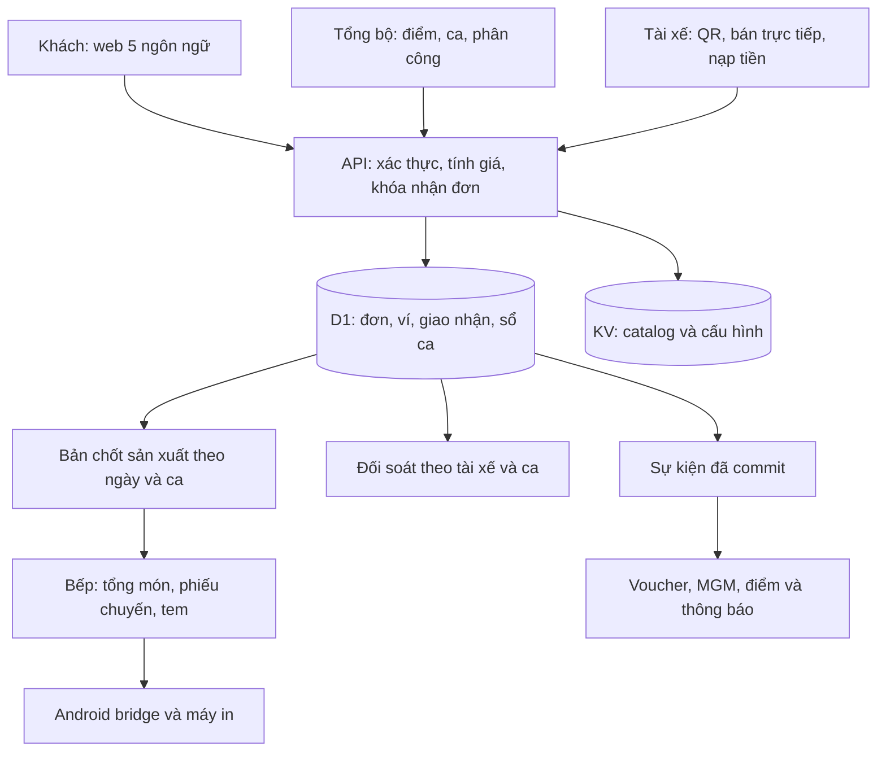

# PDP: Mở rộng Benmi cho chuỗi suất ăn ký túc xá và bếp trung tâm [New]

Ngày đánh giá: **19/10/2026**. Trạng thái: **đề xuất, chưa triển khai**.

Cơ sở: mã nguồn checkout `benmi-order`, nhánh `fix/pos-crash-and-autoprint-loop`, commit `f5546c4`; đọc bổ sung mã nguồn `blab_admin`. Đây là đánh giá mã nguồn và thiết kế, **không phải xác nhận các tính năng đã được deploy hoặc nghiệm thu trên production**. Không truy cập dữ liệu khách hàng hay thay đổi môi trường chạy thật.

Bản dịch đầy đủ: [01_ban_dich_yeu_cau.md](/Users/duc.cao/Documents/learning/benmi-order/docs/proposals/dormitory_meal_chain/01_ban_dich_yeu_cau.md).

## 1. Kết luận và mục tiêu

Benmi có nền tảng dùng lại được: cửa hàng độc lập, catalog/giá/tùy biến theo tenant, đặt món qua web/LINE, chọn ngày giờ nhận, xử lý đơn, báo cáo bán hàng từng cửa hàng, Android POS và máy in hóa đơn/tem.

Yêu cầu mới bổ sung ba hệ nghiệp vụ lớn: **quản trị chuỗi và sản xuất tập trung; hội viên với ví/ưu đãi dùng chung; giao suất ăn và đối soát tài xế**. Không thể tính là chỉ mở thêm 20 tenant hoặc thêm màn hình quản lý.

Khuyến nghị với **một dev toàn thời gian, quen codebase**:

| Mốc | Phạm vi | Thời gian lịch dự kiến tính từ lúc bắt đầu |
|---|---|---|
| Pilot rút gọn, tùy chọn | 1–2 điểm, khóa đơn, tổng hợp bếp, tài xế giới hạn điểm, thu tiền mặt, in tem; chưa có ví và marketing | 6–8 tuần, chỉ khi khách chấp nhận giảm phạm vi |
| Pilot vận hành cốt lõi | 1–2 điểm, 5 ngôn ngữ khách hàng, hội viên chung, nạp/trừ ví, QR, ca tài xế, bán trực tiếp, đối soát và in | **16–20 tuần** |
| Bản đầy đủ 20 điểm | Pilot cốt lõi + voucher, giới thiệu bạn bè, điểm, vòng quay, công cụ tổng bộ và rollout 20 điểm | **28–36 tuần tổng cộng**, khoảng 7–9 tháng |

Pilot cốt lõi chủ động hoãn marketing; **không được báo là đáp ứng 100% bản đặc tả**. Nếu khách yêu cầu tất cả tính năng ngay ở 1–2 điểm đầu, phần lớn thời gian của bản đầy đủ vẫn phải thực hiện trước pilot. Số điểm ít không làm ví, phân quyền hay chống quét trùng đơn giản đi đáng kể.

Mục tiêu đề xuất: dữ liệu từng cửa hàng độc lập; dùng chung hội viên/tiền/điểm chỉ trong cùng doanh nghiệp; mọi giao dịch tiền có dấu vết; một lần nhận hàng chỉ trừ tiền một lần; tổng phiếu bếp bằng tổng phiếu chuyến sau khi chốt.

Không bao gồm trong ước lượng cơ sở: tối ưu tuyến bằng bản đồ/GPS, ERP nguyên liệu và định mức BOM, hóa đơn điện tử, kết nối ngân hàng/thẻ, ví thanh toán khi mất mạng, ứng dụng iOS native hoặc tích hợp tùy ý mọi loại máy in. Yêu cầu bổ sung phải được ước lượng riêng.

## 2. Đối chiếu từng yêu cầu với hiện trạng

“Có nền” nghĩa là có mã phục vụ một phần nghiệp vụ; không đồng nghĩa toàn bộ luồng khách yêu cầu đã dùng được. “Chưa thấy” được xác định qua việc rà soát module, router đang chạy, schema/migration và giao diện của hai repository, không chỉ tìm từ khóa.

| Yêu cầu | Kết luận | Bằng chứng và phần cần bổ sung |
|---|---|---|
| Điểm có tên/logo/menu/giá/giờ riêng | **Có nền tảng** | `tenant_config`, catalog theo `tenant_id`, bootstrap và màn hình cấu hình. Cần kiểm thử onboarding 20 điểm và quyền thuộc cùng doanh nghiệp. [E1] |
| Tổng bộ quản lý chuỗi nhiều thương hiệu | **Có một phần** | Có admin tạo/quản lý tenant; chưa thấy mô hình doanh nghiệp sở hữu nhiều điểm, quyền tổng bộ hay dashboard vận hành hợp nhất. [E2] |
| Web đặt món, không cài ứng dụng khách hàng | **Có nền tảng** | Web/LIFF và đăng nhập LINE đã có. Chưa có hội viên chung được xác thực cho ví xuyên thương hiệu; cần chốt phương thức đăng nhập. [E3] |
| Đặt trước theo ngày/giờ | **Có một phần** | Có `allowScheduledPickup`, date/time picker, kiểm tra giờ mở cửa ở frontend. Chưa có ca nhận hàng, hạn chót riêng từng ca và khóa server theo thời điểm. [E4] |
| Báo cáo chuẩn bị suất ăn gộp 20 điểm | **Cần xây mới trên dữ liệu đơn hiện có** | Báo cáo hiện tại lọc một tenant, trạng thái `DONE/PICKED_UP/PAID`, thời điểm tạo đơn và nhóm theo tên món. Không thể dùng nguyên trạng làm phiếu sản xuất đơn đặt trước. [E5] |
| Phiếu soạn hàng theo tài xế/chuyến/điểm | **Chưa thấy** | Chưa có thực thể tuyến, chuyến, điểm dừng, phân công và bản chốt hàng. |
| Tài khoản tài xế và hạn chế điểm, khóa xóa/sửa giá | **Chưa đáp ứng** | POS xác thực PIN cửa hàng. Có migration `staff_sessions` nhưng router hiện tại không triển khai luồng session/phân quyền tài xế đó. [E6] |
| Năm ngôn ngữ đầy đủ phía khách | **Chưa đáp ứng** | POS có từ điển `zh-TW`/`vi`; frontend khách vẫn có nhiều chuỗi tiếng Trung trực tiếp. Một số mô tả song ngữ không phải hệ i18n 5 ngôn ngữ. [E7] |
| Hội viên dùng chung 20 điểm | **Chưa thấy** | Có `user_id`/tên khách trên đơn và LINE profile; chưa có tài khoản hội viên ở cấp doanh nghiệp, liên kết danh tính và lịch sử ví. |
| Quà đăng ký 100 voucher, ngưỡng và hạn 180 ngày | **Chưa thấy** | Cần campaign, phát phiếu một lần, đặt giữ/sử dụng/hoàn phiếu và hết hạn. |
| MGM thưởng 30 sau đơn đầu đã nhận | **Chưa thấy** | Cần attribution, sự kiện giao thành công và chống nhận thưởng nhiều lần. |
| Điểm chung, hết hạn 90 ngày, đổi hiện vật | **Chưa thấy** | Cần sổ điểm theo đợt cấp, thời hạn, đổi quà và tồn quà theo chuyến/điểm. |
| Vòng quay đa ngôn ngữ | **Chưa thấy** | Cần xác định lượt quay, xác suất, tồn giải, quyết định kết quả tại server và lịch sử trao thưởng. |
| Ví nạp tiền mặt dùng chung 20 thương hiệu | **Chưa thấy** | Phải xây sổ giao dịch, số dư, đối soát, hoàn/đảo giao dịch và phân biệt tiền nạp với tiền tặng. |
| Nút nạp 1.000 nhận 1.100 | **Chưa thấy** | Cần gói nạp cấu hình, quyền thao tác, xác nhận tiền đã nhận và khóa số tiền tại server. |
| Quét QR trừ tiền và giao hàng, nhiều tài xế | **Chưa thấy** | QR hiện tìm thấy là mã mở trang menu trên điện thoại; không phải QR nhận hàng hay ví. [E8] |
| Báo cáo ca tài xế và tiền phải nộp | **Chưa thấy** | “Bắt đầu ca” ở POS hiện thiên về kích hoạt giao diện/âm báo; chưa có ca tài chính gắn người thu tiền. |
| POS bán khách vãng lai và tách doanh thu | **Có nền giao diện đơn, chưa có luồng hoàn chỉnh** | Có xử lý trạng thái `PAID/PICKED_UP`; chưa thấy checkout tiền mặt của tài xế, giao dịch thu tiền hay báo cáo tách nguồn. Cột `orders.source` trong migration chưa đủ chứng minh đã triển khai. [E6, E9] |
| Máy in đơn và tem | **Có nền thực tế, cần mở rộng** | Android native bridge, ESC/POS, TSPL, TCP/Bluetooth, hàng đợi in. Browser thường có nhánh preview/mô phỏng; không thể cam kết PC/iPad in trực tiếp như Android. [E10] |
| Tem đủ mã/tên/điểm/ca/ghi chú bếp bằng Trung | **Có một phần** | Tem món có mã, tên khách, thời gian và tùy biến; cần thêm điểm nhận rõ ràng, ca phục vụ và nhãn bếp tiếng Trung được chuẩn hóa. [E10] |
| 20 điểm, gần 1.000 suất/ngày ổn định | **Chưa có bằng chứng nghiệm thu tải này** | Cần đo tải đồng thời, thời gian quét và tốc độ in thật. POS hiện polling 1,5 giây; không suy diễn thành realtime giao dịch tiền. [E11] |

### 2.1. Điểm kỹ thuật cần xử lý trước tiền thật

1. **Xác thực tại server:** router hiện gọi trực tiếp nhiều API vận hành; `handleAuth` trả `ok` sau kiểm tra PIN, không phát session có danh tính tài xế. Phải bảo vệ cả API cũ có thể tác động đến đơn/giá/số dư; chỉ giấu nút trên UI là không đủ. Đây là quan sát code, chưa kiểm tra các lớp bảo vệ hạ tầng ngoài repository.
2. **Giá và danh tính có thẩm quyền:** `createOrder` dùng `data.total`, giá item và `data.userId` từ request. Luồng tiền phải tính giá/discount theo catalog và campaign tại server, lấy hội viên từ session đã xác thực. Không dùng `userId` do client tự khai để trừ ví. [E9]
3. **Trạng thái đơn chưa thay cho giao dịch tiền:** `PAID`/`PICKED_UP` không cung cấp sổ thu chi, payment method, tài xế hoặc ca. Cần tách trạng thái chuẩn bị, thanh toán và giao hàng.
4. **Có migration chưa chắc có tính năng:** không đưa các bảng staff chưa được route sử dụng vào nhóm “đã hoàn thành”.
5. **Không dùng ngày tạo đơn làm ngày sản xuất:** đặt tối hôm trước cho sáng hôm sau phải vào ngày phục vụ và ca nhận, không vào báo cáo ngày đặt.

## 3. Kiến trúc đề xuất

### 3.1. Ranh giới dữ liệu

- Giữ mỗi điểm là một tenant để tận dụng catalog/giá/branding sẵn có.
- Thêm `organizations` và `organization_locations`: một doanh nghiệp gồm nhiều tenant. Hội viên/ví/điểm thuộc organization; menu và đơn thuộc tenant.
- Mọi khác biệt về hạn chót, ngôn ngữ, gói nạp, khuyến mại và in ấn dùng cấu hình; không hardcode 南洋食堂 hay bất kỳ tên quán nào.
- Dùng mã món sản xuất chung để ánh xạ món bán tại các điểm; cùng tên chưa chắc cùng món, khác tên có thể cùng công thức. Chưa làm BOM nguyên liệu trong phạm vi cơ sở.
- Giao diện tài xế ưu tiên web/PWA trên điện thoại; bộ điều hành bếp ưu tiên Android có bridge in hiện tại, phụ thuộc xác nhận thiết bị.

Số dư và kết quả nhận hàng lấy từ D1. KV chỉ giữ dữ liệu có thể chấp nhận trễ như catalog/config; KV có tính nhất quán cuối cùng nên không phù hợp quyết định trừ tiền hoặc “đã giao chưa”. [Cloudflare KV](https://developers.cloudflare.com/kv/concepts/how-kv-works/)

### 3.2. Mô hình dữ liệu dự kiến

| Miền | Bảng/thuộc tính chính | Ràng buộc cần có |
|---|---|---|
| Doanh nghiệp/quyền | `organizations`, `organization_locations`, `staff_accounts`, `staff_location_grants`, `staff_sessions` | Chỉ truy cập tenant được cấp; không tự mở quyền bằng `tenant_id` trên URL |
| Hội viên | `members`, `member_identities` | Một danh tính đã xác thực gắn hội viên trong organization; cơ chế gộp tài khoản có kiểm soát |
| Đặt trước | `pickup_slot_templates`, `pickup_slot_instances` | Ngày phục vụ, timezone, giờ nhận và `cutoff_at` UTC; giới hạn suất nếu cần |
| Đơn | Mở rộng đơn với organization/member/slot/source/price snapshot | `preorder` khác `walk_in`; không dùng `is_desktop` làm nguồn doanh thu |
| Bếp | `production_products`, `location_product_mappings`, `production_batches`, `production_batch_lines` | Snapshot phiên bản khi chốt; tùy biến chuẩn hóa; tổng batch nhất quán |
| Giao hàng | `delivery_runs`, `delivery_stops`, `run_assignments`, `run_inventory` | Đơn gắn chuyến/điểm; tách suất đặt trước với suất dư bán tại chỗ |
| Tiền | `wallet_accounts`, `wallet_ledger`, `topup_packages`, `payments` | Tiền theo số nguyên đơn vị nhỏ nhất; tách tiền gốc/bonus; khóa nghiệp vụ và idempotency |
| Nhận hàng/ca | `redemptions`, `driver_shifts`, `cash_movements`, `shift_closures` | Mỗi đơn chỉ có một giao nhận thành công; actor/ca/điểm được server xác định |
| Marketing | `campaigns`, `coupon_issuances`, `coupon_redemptions`, `referrals`, `points_lots`, `points_ledger`, `prize_inventory`, `wheel_draws` | Cấp thưởng một lần, TTL nghiệp vụ, hoàn thưởng có dấu vết |
| Vận hành | `audit_events`, `outbox_events`, `print_jobs` | Theo dõi actor, request ID, retry, trạng thái kết quả không rõ và in lại |

Các tên bảng là thiết kế dự kiến. Index chủ đạo: organization + tenant + ngày phục vụ + ca; tài xế + ca; wallet + thời điểm; khóa unique cho request, giao nhận và cấp thưởng. Quan hệ org/tenant phải kiểm tra ở server và ràng buộc DB phù hợp; tránh join chéo dữ liệu giữa hai doanh nghiệp. Thiết kế để sau này chia database theo organization mà không phải giao dịch ví xuyên nhiều DB.

### 3.3. API và các luồng nghiệp vụ

Namespace dự kiến `/api/orgs/:orgId/...`, `/api/member/...`, `/api/driver/...`; không coi `orgId`/`tenantId` từ client là bằng chứng phân quyền.

| Luồng | Tác nhân/kích hoạt | Xử lý và kết quả | Lỗi/kiểm soát |
|---|---|---|---|
| 1. Đặt trước | Khách chọn điểm, ca và món | `POST /api/member/orders`: nhận `location_id`, `slot_id`, item IDs, số lượng và request ID; server tính giá, lưu snapshot và cấp token nhận hàng | Từ chối sau cutoff, sai điểm, món hết; retry không tạo hai đơn |
| 2. Chốt bếp và chuyến | Đến hạn hoặc tổng bộ xuất phiếu | `POST .../production-batches`, `GET .../production-batches/:id/export`: gom theo mã sản xuất, tùy biến, ca; tách theo chuyến và điểm | Xuất lại cùng phiên bản không thay số; sửa ngoại lệ phải có delta/phiên bản mới |
| 3. Nạp tiền | Tài xế chọn hội viên, gói nạp và xác nhận đã nhận tiền | `POST /api/driver/topups`: server lấy gói nạp, ghi sổ tiền mặt + tiền gốc + bonus, gắn ca | Không cho nhập giá trị tùy ý; retry không nạp hai lần; sai phải đảo giao dịch có quyền |
| 4. Nhận suất ăn | Tài xế quét QR và xác nhận | Preview hiển thị tên/điểm/món/số tiền; `POST /api/driver/redemptions` trừ ví và ghi đã giao trong cùng đơn vị giao dịch | QR sai điểm/ca, đã dùng, thiếu tiền hoặc lỗi mạng không được hiển thị giao thành công |
| 5. Bán tại chỗ | Tài xế chọn món có trên xe và thu tiền | `POST /api/driver/walk-in-orders`: tính giá server, ghi order source, payment cash, ca và giảm tồn bán lẻ | Không lấy vào suất đã giữ cho đơn đặt trước; không sửa giá/xóa giao dịch |
| 6. Chốt ca và thưởng | Tài xế nộp tiền; sự kiện giao thành công đã commit | `POST /api/driver/shifts/:id/close`, báo cáo tiền; outbox phát thưởng theo điều kiện | Chênh lệch cần ghi nhận; outbox retry không cấp thưởng trùng; hoàn đơn liên kết điều chỉnh thưởng |

Phản hồi giao nhận dự kiến có `redemption_id`, `payment_id`, `order_status`, số tiền thực trừ, số dư sau giao dịch và dấu hiệu replay. Các lỗi nghiệp vụ dùng mã như `CUTOFF_PASSED`, `INSUFFICIENT_BALANCE`, `ALREADY_REDEEMED`, `FORBIDDEN_LOCATION`; frontend ánh xạ sang 5 ngôn ngữ.

### 3.4. Giao dịch tiền và nhiều thiết bị

- QR là token ngẫu nhiên đủ mạnh/được ký gắn với đơn, không chứa quyền sửa tiền. Camera đọc token; server kiểm tra nhân viên, điểm được cấp và trạng thái đơn. Phạm vi cơ sở là một lần nhận toàn bộ đơn; nhận từng phần cần thiết kế thêm.
- Một giao dịch thành công gồm debit ví, payment, redemption và cập nhật đơn. Cùng đơn quét trên hai máy phải có đúng một kết quả ghi tiền thành công.
- Dùng idempotency key kèm hash payload; gửi lại cùng khóa trả kết quả cũ, đổi payload bị từ chối. Ngoài request ID vẫn cần khóa unique theo đơn để ngăn hai máy dùng hai request ID khác nhau.
- D1 hỗ trợ `batch()` dạng giao dịch và rollback khi một statement lỗi. Tuy nhiên `UPDATE` không khớp dòng **không tự động là lỗi SQL**: phải thiết kế điều kiện/constraint/trigger hoặc ghi có điều kiện để không thể commit payment nếu debit không thành công. Làm spike và test cạnh tranh trước khi chốt cách triển khai. [D1 Database API](https://developers.cloudflare.com/d1/worker-api/d1-database/)
- Không dùng vòng read-balance rồi write-balance từ client. Nếu bật read replication, số dư sau thao tác phải trả từ kết quả giao dịch và đọc có bảo đảm phù hợp; session consistency không thay thế điều kiện debit tại DB. [D1 read replication](https://developers.cloudflare.com/d1/best-practices/read-replication/)
- Mất mạng hoặc timeout: hiển thị “chưa xác định kết quả”, tra lại cùng request ID. Không tự báo thành công hoặc tự trừ ví offline.
- Tiền đã ghi không bị xóa; hoàn tiền dùng bút toán đảo và quyền quản lý. Khóa ca ngăn tài xế thêm giao dịch vào ca đã chốt.

### 3.5. Đối soát và nhận diện doanh thu

Ví dụ nạp 1.000, nhận 1.100: tiền mặt thu **1.000**, tiền gốc vào ví **1.000**, tiền thưởng **100**. Không được ghi tiền mặt thu là 1.100 hoặc cộng tiền nạp lần nữa vào doanh thu bán suất ăn.

Báo cáo ca cần ít nhất: tiền nạp mặt; tiền bán trực tiếp; tiền mặt thu cho đơn đặt trước nếu cho phép; khoản chi/hoàn được duyệt; tiền gốc và bonus đã dùng; đơn đã giao; nguồn đơn; tiền thực nộp và chênh lệch. Công thức kiểm soát vận hành: tiền phải bàn giao = tiền mặt đầu ca + tiền nạp mặt + tiền bán mặt − khoản hoàn/chi mặt được duyệt. Nếu không có tiền đầu ca hoặc chi, cấu hình các khoản đó bằng 0.

Doanh thu phải phân theo **nguồn đơn**, cách thanh toán theo **payment method**; hai chiều độc lập. Giữ riêng ngày đặt, ngày phục vụ, thời điểm thu tiền và thời điểm giao để tránh cộng sai giữa hai ngày. Đây là thiết kế báo cáo nghiệp vụ; chưa thay thế chính sách ghi nhận kế toán của doanh nghiệp.

### 3.6. Ngôn ngữ, in ấn và hàng trên xe

- Năm từ điển UI phải bao phủ cả lỗi, đăng ký, ví, QR, coupon và trạng thái đơn; backend trả error codes. Dữ liệu món/modifier có bản dịch theo locale và tên bếp `zh-TW` chuẩn.
- Ghi chú tự do do khách nhập không thể mặc nhiên biến thành tiếng Trung chuẩn; ưu tiên các tùy chọn cấu hình sẵn “cay/thêm cơm”. Với ghi chú tự do cần quy trình duyệt hoặc quy định rõ giới hạn.
- Tem lưu snapshot tên khách, mã nhận, điểm, ngày/ca, món và tùy biến tiếng Trung. Không dùng brand đang chọn trên máy bếp để suy ra điểm nhận khi in nhiều tenant.
- Hàng đợi in tập trung theo batch/chuyến; phân biệt gửi thành công đến máy với xác nhận tờ giấy thật đã in. Kết quả không rõ phải yêu cầu kiểm tra/in lại có đánh dấu, tránh tự in trùng.
- Hàng trên xe chia ít nhất: đã giữ cho đơn đặt trước; dư được bán tại chỗ; đã giao; còn lại/hao hụt. Nếu nhiều người bán cùng chuyến, việc giảm tồn cũng phải chống cạnh tranh.

## 4. Kế hoạch triển khai cho một dev

### 4.1. Giả định ước lượng

- Một dev quen TypeScript, frontend Benmi và Cloudflare, làm toàn thời gian **5 ngày/tuần**, một ngày công khoảng **6 giờ tập trung**. Không giả định có dev/QA thứ hai hoặc nhiều tác vụ lập trình chạy song song.
- Ngày công dưới đây đã gồm tự kiểm thử, review và viết tài liệu trong từng hạng mục. Cộng **20% dự phòng kỹ thuật** sau subtotal; UAT hiện trường được tính thêm theo lịch.
- Khách cung cấp menu/mapping món, người duyệt 5 ngôn ngữ, thiết bị và người vận hành để UAT. Dev làm bộ từ điển và bản dịch nháp, không kiêm người bản ngữ nghiệm thu.
- Baseline đăng nhập khách là một phương thức định danh đã xác thực dùng chung, ưu tiên tận dụng LINE nếu khách đồng ý. Nếu bắt buộc đăng ký số điện thoại/OTP và phục hồi tài khoản độc lập LINE: cộng sơ bộ **5–8 ngày công**, tùy nhà cung cấp và quy trình.
- Một bộ phần cứng đã thống nhất; tài xế cần mạng. Không tính thời gian chờ mua thiết bị, duyệt nội dung, ngày lễ hoặc chờ khách quyết định.
- Nếu dev chỉ dành được 60% thời gian vì bảo trì Benmi và hỗ trợ hiện trường, phần thời gian phát triển phải chia cho 0,6; không giữ nguyên lịch toàn thời gian.

### 4.2. Pilot cốt lõi — 1–2 điểm

| Thứ tự | Hạng mục và đầu ra nghiệm thu | Ngày công |
|---|---|---:|
| P0 | Chốt quy trình/no-show/hoàn tiền, mô hình dữ liệu, spike debit cạnh tranh và xác nhận bộ máy in | 4–5 |
| P1 | Organization, staff account/session, quyền điểm và quyền thao tác; bảo vệ API; tính giá server | 7–9 |
| P2 | Ca nhận, cutoff server, ngày phục vụ, snapshot bếp, mapping món, phiếu chuyến cơ bản | 6–8 |
| P3 | Hội viên chung/định danh, tách i18n khách hàng đủ 5 ngôn ngữ, UI đăng ký và chọn điểm | 8–10 |
| P4 | Ví tiền gốc/bonus, gói nạp, payment, idempotency, đảo/hoàn cơ bản và audit | 10–13 |
| P5 | UI tài xế, mở/chốt ca, QR, bán trực tiếp tiền mặt, tồn suất dư, đối soát ca | 6–8 |
| P6 | Tem đủ trường, phiếu bếp/chuyến, hàng đợi in trung tâm, thử máy thật | 5–6 |
| P7 | Tích hợp, test cạnh tranh/phân quyền, lỗi mạng, kiểm thử 5 ngôn ngữ, sửa lỗi, tài liệu/đào tạo | 10–13 |
| **Tổng** | | **56–72** |

Sau dự phòng 20%: **67–87 ngày công**, tương đương khoảng **14–18 tuần làm việc**. Thêm **2 tuần chạy UAT và ổn định thực địa**: cửa sổ kế hoạch **16–20 tuần**. Làm tuần tự theo phụ thuộc; có thể xen chỉnh UI vào thời gian chờ duyệt, không tính là có thêm người.

Ví dụ phân bổ ở mức giữa khoảng: tuần 1 P0; tuần 2–3 P1; tuần 4–5 P2; tuần 6–7 P3; tuần 8–10 P4; tuần 11–12 P5; tuần 13 P6; tuần 14–16 P7/dự phòng; tuần 17–18 UAT. Đây là bản lịch minh họa, không cộng thêm lần nữa ngoài estimate trên.

Phải chạy thử **2 điểm với menu/giá khác nhau** để chứng minh ví liên điểm và phân quyền. Chạy duy nhất 1 điểm không kiểm chứng được yêu cầu xuyên thương hiệu.

### 4.3. Hoàn thiện marketing và mở rộng 20 điểm

| Thứ tự | Hạng mục | Ngày công bổ sung |
|---|---|---:|
| P8 | Campaign/voucher đăng ký, ngưỡng, hạn tương đối, giữ/đổi/hoàn phiếu | 6–8 |
| P9 | MGM, cấp thưởng sau đơn đầu đã giao, chống tự giới thiệu và cấp trùng | 5–7 |
| P10 | Sổ điểm theo ngày hết hạn, đổi hiện vật, quản lý tồn quà, liên điểm | 6–8 |
| P11 | Vòng quay 5 ngôn ngữ, lượt quay, kết quả server, tồn giải và lịch sử | 5–7 |
| P12 | Tổng bộ hoàn chỉnh: quản lý hàng loạt điểm/menu/mapping/chuyến, báo cáo hợp nhất | 7–9 |
| P13 | Regression toàn luồng marketing/tiền; load test; diễn tập 20 điểm; nhập dữ liệu và chuẩn bị rollout | 14–18 |
| **Tổng bổ sung** | | **43–57** |

Cộng dự phòng 20%: **52–69 ngày công** ≈ **11–14 tuần**; thêm **1–2 tuần mở rộng thực địa theo đợt**: **12–16 tuần sau pilot**. Tổng hai giai đoạn: **28–36 tuần**. Tổng effort cơ sở **99–129 ngày công**, có dự phòng khoảng **119–155 ngày công**, chưa quy đổi phần trực hiện trường thành chi phí thương mại.

Nếu ưu tiên mở 20 điểm trước marketing, có thể đưa P12 và phần kiểm thử tải của P13 lên trước P8–P11. Khi đó đó là “20 điểm vận hành cốt lõi”, chưa phải “20 điểm đầy đủ đặc tả”; phải tính lại mốc theo phạm vi được khách chốt.

### 4.4. Pilot rút gọn nếu cần chứng minh sớm

Khoảng **20–25 ngày công cơ sở**, cộng 20% và 1–2 tuần chạy thực địa → **6–8 tuần**. Phạm vi: auth tài xế giới hạn điểm, đặt trước/cutoff, tổng món bếp, phiếu chuyến đơn giản, tem, giao suất ăn và báo cáo tiền mặt; sử dụng giao diện/ngôn ngữ sẵn có hoặc chỉ ngôn ngữ cần tại điểm thử theo thỏa thuận.

Chưa có ví liên điểm, nạp tiền bonus, marketing và đủ 5 ngôn ngữ. Không dùng kết quả này để kết luận đã kiểm thử tải cho luồng ví. Đây là **lựa chọn thay thế trình tự pilot**, không phải khoản effort cộng thêm mặc định vào P0–P13; nếu chọn cần tái lập baseline để tránh tính trùng.

## 5. Migration, rollout và rollback

1. Thêm bảng và trường nullable/default an toàn; giữ tenant hiện hữu hoạt động. Không tự ghép dữ liệu khách giữa các doanh nghiệp.
2. Gắn feature flags theo organization/tenant; tạo hai điểm thử và catalog riêng. Xác thực/ràng buộc cho luồng mới bắt buộc từ ngày đầu; lộ trình chuyển POS cũ sang session cần được kiểm thử tương thích.
3. Chạy shadow báo cáo bếp với cùng dữ liệu, so số lượng thủ công; ví dùng dữ liệu thử trước khi thu tiền thật. Nếu chuyển số dư có sẵn, dùng bút toán số dư đầu kỳ có đối soát và phê duyệt.
4. Dev → staging → production bằng các npm scripts `cf` của repository; migration additive trước, code sau. Không dùng `wrangler deploy`.
5. UAT hai điểm tối thiểu 10 ngày vận hành liên tiếp với ca sáng và chiều. Tăng lần lượt **2 → 5 → 10 → 20 điểm**, mỗi đợt theo tiêu chí chấp nhận.
6. Dừng mở rộng nếu có trừ tiền hai lần, chênh lệch tiền không giải thích được, truy cập chéo điểm hoặc giao nhầm do tem.
7. Rollback bằng tắt tính năng nhận giao dịch mới và quay về quy trình dự phòng đã diễn tập. **Không khôi phục DB cũ làm mất các giao dịch tiền đã commit**; giữ sổ, thực hiện bút toán điều chỉnh và đối soát. Khi thiếu mạng, phương án tiền mặt/phiếu ngoại lệ phải được đánh dấu riêng, tránh giao lại đơn khi kết nối phục hồi.

## 6. Kiểm thử và tiêu chí nghiệm thu

Các con số hiệu năng sau là **mục tiêu đề xuất cần đo và thống nhất**, không phải kết quả của hệ thống hiện tại.

| Nhóm | Ca kiểm thử/điều kiện đạt |
|---|---|
| Khóa đơn | Ca 05:30 ngày mai cutoff 20:00 hôm nay ở `Asia/Taipei`; chặn create/modify/append sau cutoff tại server, kiểm tra ranh giới chính xác và đổi ngày |
| Phân quyền | Đổi tenant/org trên URL/body, gọi trực tiếp API cũ, token hết hạn/thu hồi, tài xế gọi sửa giá/xóa đơn đều không vượt quyền |
| Tính giá | Sửa total/price/memberId gửi lên không thay giá hoặc người bị trừ tiền; snapshot giá không đổi khi menu đổi |
| Ví | Hai máy cùng tiêu tiền ở hai điểm; hai máy quét cùng QR; thiếu tiền; request lặp; lỗi giữa chừng; hoàn hai lần: không số dư âm, không debit đôi, không orphan payment |
| Đối soát | Nạp 1.000 tặng 100; mua bằng ví; bán tiền mặt; hoàn; đổi ca: tiền mặt đúng, bonus riêng, không cộng doanh thu hai lần |
| Bếp | Cùng món khác tên/giá, khác món cùng tên, modifier/thêm phần/combo, đặt hôm trước: tổng chuẩn và phân đúng ngày/ca/chuyến |
| Vận chuyển | Không bán phần giữ cho đơn đặt trước; ca đóng không nhận thêm giao dịch; hai tài xế cùng bán suất dư không bán vượt tồn |
| Marketing | Cấp 100 phiếu một lần; ngưỡng 70; hết hạn 180 ngày; điểm 90 ngày; referral chỉ trả sau nhận thành công; hoàn/no-show không tạo thưởng sai; kho giải không âm |
| In | Tên khách dài, tiếng Thái/Việt, 5 trường bắt buộc, tùy biến bếp tiếng Trung; hết giấy/mất Bluetooth; in lại có dấu; không trộn điểm |
| Tải | Dữ liệu ít nhất 20 điểm × tổng 1.000 suất/ngày, đơn và số suất phân biệt rõ; mô phỏng dồn ca, 20 máy tài xế + màn bếp; baseline 10 giao nhận/giây, burst 30/giây trong 60 giây để thử headroom, rồi hiệu chỉnh theo đo thực địa |
| Trải nghiệm | Mục tiêu p95 API xác nhận <1 giây trong điều kiện đo đã chốt; từ khi đọc được QR đến hiển thị kết quả <2 giây trên mạng 4G đủ tốt; không lấy thời gian đưa camera vào mã làm latency API |
| UAT | 10 ngày vận hành liên tiếp không debit trùng/không chênh lệch tiền không giải thích được; tổng bếp = tổng phân bổ chuyến; hoàn thành phát suất ăn đúng khung giờ |

Thời gian in 1.000 tem phải đo trên thiết bị thật và khổ giấy thật. Tải 1.000 **suất** không đồng nhất 1.000 **đơn**, và trung bình cả ngày không thể đại diện giờ cao điểm.

Khi triển khai: bắt buộc `npm run check` frontend, backend typecheck và các test tích hợp liên quan; bump cache-buster HTML cho CSS/JS; test transaction/permission/load có dữ liệu staging; không load-test production. Đánh giá này chỉ thêm tài liệu nên chưa chạy hay tạo các test triển khai đó.

## 7. Các mối quan tâm xuyên suốt và phương án thay thế

**Bảo mật:** tài xế có tài khoản riêng, session thu hồi được; quyền nhỏ nhất, rate limit đăng nhập/QR/nạp; quản lý mới được đảo tiền; log không chứa token nhận hàng hay dữ liệu cá nhân không cần thiết. Backend tự xác thực danh tính và mọi phép đổi tiền/giá.

**Quan sát:** log organization, tenant, order, member tham chiếu nội bộ, actor, shift, request ID và transaction ID; cảnh báo debit lỗi, quét trùng, chênh lệch ca, tồn âm, backlog in và tỷ lệ lỗi mạng. Báo cáo ví có truy xuất từ số dư về từng bút toán.

**Hiệu năng:** giữ bootstrap/cache tenant cho menu; không quét toàn lịch sử ở mỗi lần polling; phân trang/filter theo điểm và ca, index phục vụ truy vấn, export theo snapshot. Chỉ cân nhắc push/SSE hoặc Durable Objects sau khi đo cho thấy cần; không thêm stack lớn vào pilot nếu D1 giao dịch đã đáp ứng.

| Phương án | Ưu điểm | Hạn chế | Quyết định đề xuất |
|---|---|---|---|
| Mở rộng tenant hiện có + organization + giao dịch D1 | Dùng lại menu, POS, in; báo cáo SQL tập trung | Phải xử lý auth và transaction cẩn thận | Chọn làm baseline, spike trước |
| Mỗi điểm hoàn toàn tách biệt, gộp Excel | Pilot tiền mặt nhanh | Không có ví chung/đối soát tự động, khó quản lý sai lệch | Chỉ dùng pilot rút gọn có thỏa thuận |
| Tách dịch vụ ví sang Durable Objects ngay | Có cơ chế tuần tự theo đối tượng | Phải giải quyết đồng bộ ví–đơn–báo cáo giữa hai nơi | Chưa chọn; đánh giá lại nếu spike/tải D1 không đạt |
| Viết lại toàn bộ nền tảng | Tự do kiến trúc mới | Tăng phạm vi, lãng phí tài sản in/menu, kéo dài một dev | Không chọn |

## 8. Cơ sở báo giá hai giai đoạn

Chưa có đơn giá ngày công hay chính sách thương mại nên **không đưa con số tiền hoặc phần trăm chiết khấu giả định thành báo giá chính thức**. Dự toán nên tách:

- Pilot cốt lõi: 56–72 ngày công cơ sở; ngân sách kỹ thuật có dự phòng khoảng 67–87 ngày công.
- Mở rộng đầy đủ: **43–57 ngày công bổ sung**, khoảng 52–69 có dự phòng; phần lõi đã xây ở pilot không tính lại.
- Hạ tầng/hosting, domain, dịch vụ định danh/OTP nếu dùng, thiết bị/giấy in, dịch thuật duyệt bản ngữ, trực hỗ trợ và bảo trì được liệt kê riêng.
- Công thức minh bạch: phí triển khai = ngày công đã thống nhất × đơn giá ngày công + hạng mục ngoài công; sau đó áp dụng chiết khấu thương mại do bên cung cấp quyết định.
- Có thể đề xuất khấu trừ phí pilot vào hợp đồng mở rộng hoặc giảm phí onboarding theo số điểm. Không coi phí 1–2 điểm đơn thuần là 1/10 phí dự án 20 điểm vì phần lõi ví/phân quyền được xây ngay từ đầu.
- “Không thu hoa hồng nạp tiền” là điều khoản thương mại phải được chốt; có thể thiết kế phí cố định, không tự suy ra từ code rằng hệ thống hiện tại đã có cam kết này.

## 9. Các quyết định cần khách chốt để khóa tiến độ

1. Pilot có được hoãn voucher/MGM/điểm/vòng quay hay phải đủ tất cả ngay? Có cần 5 ngôn ngữ trong pilot không?
2. Khách đăng nhập LINE có phù hợp tất cả nhóm lao động không, hay bắt buộc số điện thoại/OTP? Ai duyệt bản dịch?
3. Đặt trước khi chưa đủ số dư có được phép không? Có giữ tiền lúc đặt không? Không tới nhận, hết giờ, hủy sau cutoff và hoàn tiền xử lý thế nào? Baseline là trừ khi nhận như nguyên văn; thêm giữ tiền làm thay đổi luồng.
4. 100 voucher áp dụng mỗi hội viên hay cả chiến dịch; một đơn dùng bao nhiêu phiếu; có dùng kèm điểm/bonus không; điểm thưởng tính trước hay sau giảm giá?
5. Có cho trả tiền mặt cho đơn đặt trước thiếu ví hoặc chia một đơn nhiều cách thanh toán không? Baseline không chia tender.
6. Chuyến có một hay nhiều tài xế, có chuyển đơn giữa chuyến, đổi tài xế giữa ca và nhận một phần đơn không?
7. Tổng điểm cuối là 20 hay 21–22; số suất sáng/chiều, số điện thoại hoạt động đồng thời và sóng tại điểm thực tế ra sao?
8. Máy điều hành Android/Windows/iPad; model máy in, số máy, khổ tem và kết nối; ai hỗ trợ hiện trường lúc 05:30 và 19:00?

## 10. Bằng chứng mã nguồn

| Mã | Vị trí đã đọc | Kết luận được hỗ trợ |
|---|---|---|
| E1 | [bootstrap.ts:42](/Users/duc.cao/Documents/learning/benmi-order/benmi-worker-official/src/modules/bootstrap.ts:42), [menu schema:22](/Users/duc.cao/Documents/learning/benmi-order/benmi-worker-official/migrations/0001_initialize_menu_tables.sql:22), [config.ts:65](/Users/duc.cao/Documents/learning/benmi-order/benmi-worker-official/src/modules/config.ts:65) | Branding, giá, catalog, giờ và feature theo tenant |
| E2 | [admin.ts:13](/Users/duc.cao/Documents/learning/benmi-order/benmi-worker-official/src/modules/admin.ts:13), [admin types:33](/Users/duc.cao/Documents/learning/blab_admin/src/types/index.ts:33), [admin auth:4](/Users/duc.cao/Documents/learning/blab_admin/worker/auth.ts:4) | Admin tenant/Cloudflare Access có sẵn; không phải quyền chuỗi và tài xế |
| E3 | [client-core.js:736](/Users/duc.cao/Documents/learning/benmi-order/js/client-core.js:736), [client-checkout.js:1732](/Users/duc.cao/Documents/learning/benmi-order/js/client-checkout.js:1732) | Web/LIFF, profile khách; chưa tương đương member wallet |
| E4 | [client-checkout.js:1433](/Users/duc.cao/Documents/learning/benmi-order/js/client-checkout.js:1433), [orders.ts:372](/Users/duc.cao/Documents/learning/benmi-order/benmi-worker-official/src/modules/orders.ts:372) | Ngày giờ chọn ở client; chưa có slot/cutoff server |
| E5 | [reports.ts:51](/Users/duc.cao/Documents/learning/benmi-order/benmi-worker-official/src/modules/reports.ts:51) | Report tenant, ngày tạo và trạng thái hoàn thành, nhóm theo tên |
| E6 | [auth.ts:22](/Users/duc.cao/Documents/learning/benmi-order/benmi-worker-official/src/modules/auth.ts:22), [index.ts:65](/Users/duc.cao/Documents/learning/benmi-order/benmi-worker-official/src/index.ts:65), [staff migration:25](/Users/duc.cao/Documents/learning/benmi-order/benmi-worker-official/migrations/0057_create_staff_ordering_and_tables.sql:25) | PIN, route thực tế, bảng staff/source chưa tạo thành luồng tài xế |
| E7 | [orders-i18n.js:1283](/Users/duc.cao/Documents/learning/benmi-order/js/orders-i18n.js:1283), [client-checkout.js:1449](/Users/duc.cao/Documents/learning/benmi-order/js/client-checkout.js:1449) | POS hai ngôn ngữ; frontend khách còn chuỗi trực tiếp |
| E8 | [client-core.js:578](/Users/duc.cao/Documents/learning/benmi-order/js/client-core.js:578) | QR chuyển trang menu, chưa phải nhận hàng |
| E9 | [orders.ts:514](/Users/duc.cao/Documents/learning/benmi-order/benmi-worker-official/src/modules/orders.ts:514), [orders.ts:566](/Users/duc.cao/Documents/learning/benmi-order/benmi-worker-official/src/modules/orders.ts:566), [orders-modals.js:411](/Users/duc.cao/Documents/learning/benmi-order/js/orders-modals.js:411) | Giá/total từ request; trạng thái đã nhận/trả tiền chưa là sổ giao dịch |
| E10 | [printer-service.js:1157](/Users/duc.cao/Documents/learning/benmi-order/js/printer-service.js:1157), [printer-service.js:1205](/Users/duc.cao/Documents/learning/benmi-order/js/printer-service.js:1205), [printer-service.js:1224](/Users/duc.cao/Documents/learning/benmi-order/js/printer-service.js:1224), [ThermalPrinterPlugin.java:113](/Users/duc.cao/Documents/learning/benmi-order/apps/android-pos/android/app/src/main/java/com/benmi/pos/ThermalPrinterPlugin.java:113) | Tem, native TCP/Bluetooth và browser preview |
| E11 | [orders-core.js:1058](/Users/duc.cao/Documents/learning/benmi-order/js/orders-core.js:1058) | POS polling mỗi 1,5 giây |

Các link phản ánh checkout tại ngày đánh giá. Kết luận “chưa thấy” không phủ nhận có thể có dịch vụ ngoài hai repository hoặc tính năng ở nhánh khác; trước báo giá cố định cần xác nhận baseline release và chạy demo/staging của phiên bản sẽ bàn giao.
