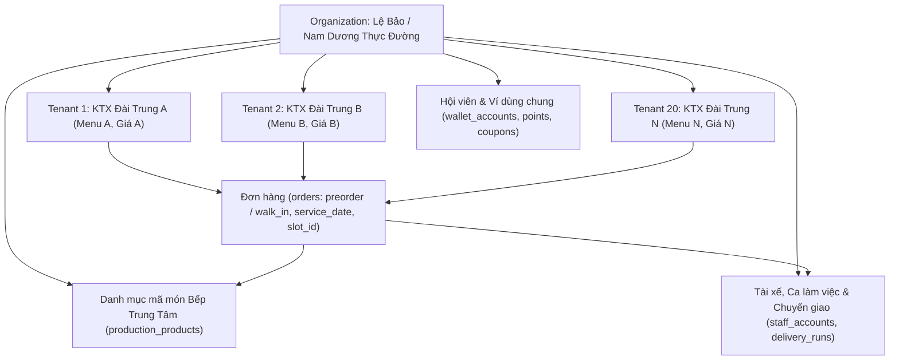

# Đánh giá kỹ thuật và kế hoạch phát triển (Bản dành cho CTO)

Tài liệu này đối chiếu trực tiếp yêu cầu dự án chuỗi 20 điểm cơm hộp ký túc xá của **麗寶國際餐飲事業有限公司** (thương hiệu **南洋食堂**) với mã nguồn hiện tại của `benmi-order`, chỉ ra các điểm nghẽn kỹ thuật và lập kế hoạch phát triển thực tế cho **1 developer làm việc toàn thời gian**.

---

## 1. Đối chiếu thực trạng codebase Benmi với yêu cầu khách hàng

Trong bảng dưới đây, "Đã có" nghĩa là tính năng đang chạy ổn định và dùng lại được ngay; "Có một phần" nghĩa là đã có sẵn một nửa luồng hoặc bảng dữ liệu nhưng chưa đáp ứng đúng nghiệp vụ bếp trung tâm và xe lưu động; "Chưa có" nghĩa là phải thiết kế và viết mới hoàn toàn.

| Hạng mục yêu cầu | Hiện trạng Benmi | Chi tiết trong mã nguồn hiện tại và phần việc phải làm thêm |
| :--- | :--- | :--- |
| **1. Đa thương hiệu (20 điểm độc lập tên, logo, menu, giá, giờ mở cửa)** | **Đã có nền tảng** | Bảng `tenant_config`, catalog theo `tenant_id` ([`0001_initialize_menu_tables.sql`](file:///Users/duc.cao/Documents/learning/benmi-order/benmi-worker-official/migrations/0001_initialize_menu_tables.sql#L22)), cache KV bootstrap ([`bootstrap.ts`](file:///Users/duc.cao/Documents/learning/benmi-order/benmi-worker-official/src/modules/bootstrap.ts#L42)) và cấu hình quán ([`config.ts`](file:///Users/duc.cao/Documents/learning/benmi-order/benmi-worker-official/src/modules/config.ts#L65)) đã tách độc lập từng quán. Cần thêm bảng `organizations` ở tầng trên để gom 20 `tenant_id` về chung một công ty mẹ (phục vụ ví chung và báo cáo tổng bộ). |
| **2. Khách đặt món trên web điện thoại, không cần cài App** | **Đã có nền tảng** | Giao diện [`index.html`](file:///Users/duc.cao/Documents/learning/benmi-order/index.html), [`client-core.js`](file:///Users/duc.cao/Documents/learning/benmi-order/js/client-core.js#L736) và [`client-checkout.js`](file:///Users/duc.cao/Documents/learning/benmi-order/js/client-checkout.js#L1732) đã chạy tốt trên trình duyệt di động và LINE LIFF. Tuy nhiên, định danh khách hiện mới dừng ở `userId` của LINE hoặc tên/số điện thoại nhập tay theo từng đơn, chưa có tài khoản hội viên xác thực xuyên 20 thương hiệu. |
| **3. Đặt trước và tự động khóa đơn (Cutoff) theo từng ca** | **Có một phần** | Frontend đã có chọn ngày giờ nhận hàng (`allowScheduledPickup` tại [`client-checkout.js`](file:///Users/duc.cao/Documents/learning/benmi-order/js/client-checkout.js#L1433)), lưu chuỗi giờ hẹn vào đơn ([`orders.ts`](file:///Users/duc.cao/Documents/learning/benmi-order/benmi-worker-official/src/modules/orders.ts#L372)). Chưa có khái niệm "Ca nhận hàng" (ca sáng 05:30-08:00, ca chiều 17:00-19:00), chưa có giờ khóa sổ (`cutoff_at`, ví dụ 20:00 tối hôm trước khóa đơn ca 05:30 sáng hôm sau) và chưa chặn cứng tại backend khi quá giờ. |
| **4. Báo cáo gộp 20 điểm cho bếp trung tâm và tách phiếu theo chuyến xe** | **Chưa có (phải viết mới)** | Báo cáo hiện tại ([`reports.ts`](file:///Users/duc.cao/Documents/learning/benmi-order/benmi-worker-official/src/modules/reports.ts#L51)) chỉ truy vấn từng `tenant_id`, lọc theo ngày tạo đơn (`created_at`), trạng thái `DONE/PICKED_UP/PAID` và gom theo chuỗi tên món. Với bếp trung tâm, khách đặt tối hôm trước cho sáng hôm sau phải tính vào ngày phục vụ (`service_date`); 20 điểm bán khác tên/khác giá nhưng cùng một món cốt lết/đùi gà ở bếp phải gom theo mã sản xuất (`production_sku_id`); và phải thêm thực thể Chuyến xe (`delivery_runs`) để tách phiếu soạn hàng theo từng tài xế. |
| **5. Tài khoản tài xế, giới hạn quyền theo điểm, khóa xóa đơn/sửa giá** | **Chưa có** | POS hiện xác thực bằng một mã PIN chung của cửa hàng ([`auth.ts`](file:///Users/duc.cao/Documents/learning/benmi-order/benmi-worker-official/src/modules/auth.ts#L22)). Trong DB từng có migration tạo bảng `staff_sessions` ([`0057_create_staff_ordering_and_tables.sql`](file:///Users/duc.cao/Documents/learning/benmi-order/benmi-worker-official/migrations/0057_create_staff_ordering_and_tables.sql#L25)), nhưng router [`index.ts`](file:///Users/duc.cao/Documents/learning/benmi-order/benmi-worker-official/src/index.ts#L65-L93) chưa sử dụng bảng này để kiểm tra quyền. Phải xây dựng đăng nhập theo từng tài xế, gắn danh sách điểm được phép xem (`staff_location_grants`) và chặn các API xóa đơn/sửa giá ở tầng middleware backend. |
| **6. Giao diện khách hàng 5 ngôn ngữ (Trung, Việt, Indo, Thái, Anh)** | **Có một phần nhỏ** | Trang POS quản lý đã có kiến trúc từ điển 2 ngôn ngữ `zh-TW` và `vi` ([`orders-i18n.js`](file:///Users/duc.cao/Documents/learning/benmi-order/js/orders-i18n.js#L1283)). Tuy nhiên, trang đặt món của khách (`index.html`, `js/client-*.js`) vẫn còn nhiều chuỗi tiếng Trung nằm trực tiếp trong code ([`client-checkout.js`](file:///Users/duc.cao/Documents/learning/benmi-order/js/client-checkout.js#L1449)). Phải tách toàn bộ text phía khách ra từ điển 5 ngôn ngữ và mở rộng cấu trúc dữ liệu menu để lưu tên món/tùy biến theo 5 thứ tiếng, đồng thời giữ tên món tiếng Trung cố định cho bếp. |
| **7. Quà đăng ký mới (100 phiếu giảm 10 TWD, đơn từ 70 TWD, hạn 180 ngày)** | **Chưa có** | Hệ thống mới có giảm giá theo combo/ngưỡng giỏ hàng ([`0049_create_universal_bundle_and_threshold_rules.sql`](file:///Users/duc.cao/Documents/learning/benmi-order/benmi-worker-official/migrations/0049_create_universal_bundle_and_threshold_rules.sql)). Chưa có kho voucher cá nhân (`coupon_issuances`), hạn dùng tương đối theo ngày đăng ký, kiểm soát dùng 1 phiếu/đơn và hoàn phiếu khi hủy đơn trước giờ chốt. |
| **8. Giới thiệu bạn bè (MGM) tặng 30 TWD sau khi bạn nhận cơm thành công** | **Chưa có** | Cần làm mới hoàn toàn: tạo mã/link giới thiệu, ghi nhận quan hệ giới thiệu (`referrals`), chống tự giới thiệu, và lắng nghe sự kiện đơn hàng đầu tiên của người được giới thiệu chuyển sang trạng thái đã nhận cơm thực tế (`REDEEMED`) mới phát hành voucher 30 TWD. |
| **9. Vòng quay may mắn và tích điểm 90 ngày đổi hiện vật (mì gói, nước ngọt)** | **Chưa có** | Cần xây sổ cái điểm thưởng theo từng lô tích lũy (`points_lots`) để xử lý hết hạn 90 ngày, quy đổi điểm ra quà hiện vật kèm quản lý tồn kho quà trên chuyến xe, và module vòng quay kiểm soát tỷ lệ trúng thưởng tại server. |
| **10. Ví trả trước dùng chung 20 điểm và nút nạp nhanh (nạp 1.000 nhận 1.100)** | **Chưa có** | Phải xây mới toàn bộ hệ thống sổ cái ví (`wallet_accounts`, `wallet_ledger`), tách bạch tiền nạp gốc (`principal`) và tiền tặng (`bonus`), cấu hình các gói nạp cố định (`topup_packages`) để tài xế bấm 1 chạm trên điện thoại, tránh nhập tay sai số tiền. |
| **11. Nhiều tài xế đồng thời quét QR trừ tiền ví và xác nhận nhận cơm** | **Chưa có** | Mã QR hiện có trong [`client-core.js`](file:///Users/duc.cao/Documents/learning/benmi-order/js/client-core.js#L578) chỉ là QR dẫn vào link menu quán. Phải làm mới luồng sinh token QR cho từng đơn đặt trước, màn hình camera quét mã trên điện thoại tài xế, giao dịch nguyên tử (atomic transaction) vừa trừ tiền ví vừa đổi trạng thái giao hàng, và báo cáo thu ngân theo ca của từng tài xế. |
| **12. POS lưu động bán cơm trực tiếp trên xe và tách doanh thu đặt trước / vãng lai** | **Có một phần giao diện** | Đã có nền chọn món và đánh dấu `PAID/PICKED_UP` trên POS ([`orders-modals.js`](file:///Users/duc.cao/Documents/learning/benmi-order/js/orders-modals.js#L411)), có cột `source` trong migration nhưng chưa hoàn thiện luồng thu ngân trên xe cho tài xế, chưa quản lý số lượng suất cơm dư mang theo xe để bán lẻ, và chưa tách riêng hai dòng doanh thu trên báo cáo chốt ca. |
| **13. Máy in tại bếp và in tem dán hộp đủ 5 trường thông tin** | **Đã có nền tảng tốt** | App Android POS đã có bridge in nhiệt ESC/POS và in tem nhãn TSPL qua Bluetooth/LAN ([`printer-service.js`](file:///Users/duc.cao/Documents/learning/benmi-order/js/printer-service.js#L1157-L1224), [`ThermalPrinterPlugin.java`](file:///Users/duc.cao/Documents/learning/benmi-order/apps/android-pos/android/app/src/main/java/com/benmi/pos/ThermalPrinterPlugin.java#L113)). Hiện tem đã in được mã đơn, tên khách, giờ và tùy biến; chỉ cần bổ sung trường **Điểm nhận (Ký túc xá)**, **Ca nhận** và ép phần tùy biến món selalu xuất bằng **tiếng Trung** cho đầu bếp đọc, bất kể khách đặt bằng tiếng Việt hay tiếng Thái. |

---

## 2. Bốn lỗ hổng kỹ thuật trong code hiện tại bắt buộc phải gia cố trước khi làm Ví tiền thật

Nếu chỉ tận dụng API hiện có rồi ghép thêm giao diện ví và tài xế lên trên, hệ thống sẽ gặp rủi ro mất tiền hoặc lệch sổ ngay tuần đầu chạy thử:

1. **API vận hành đang thiếu lớp kiểm tra phiên đăng nhập và phân quyền tại server:**
   Trong [`auth.ts`](file:///Users/duc.cao/Documents/learning/benmi-order/benmi-worker-official/src/modules/auth.ts#L22-L56), hàm `handleAuth` chỉ kiểm tra mã PIN của quán rồi trả về `{ ok: true }`. Các endpoint như `/api/orders`, `/api/update`, `/api/modify`, `/api/menu` trong [`index.ts`](file:///Users/duc.cao/Documents/learning/benmi-order/benmi-worker-official/src/index.ts#L65-L93) hiện nhận `tenant_id` trực tiếp từ query/body mà không bắt buộc Bearer token gắn với danh tính nhân viên. Khi giao cho nhiều tài xế, không thể chỉ ẩn nút "Xóa đơn / Sửa giá" bằng CSS/JS ở frontend, mà bắt buộc phải có middleware kiểm tra token phiên đăng nhập của tài xế, khóa cứng danh sách `tenant_id` tài xế đó được phép truy cập và từ chối mọi lệnh sửa giá/xóa đơn ở tầng Worker.
2. **Giá đơn hàng và định danh người mua đang tin tưởng vào dữ liệu từ client:**
   Trong [`orders.ts`](file:///Users/duc.cao/Documents/learning/benmi-order/benmi-worker-official/src/modules/orders.ts#L514-L566), `createOrder` đang đọc `data.total`, giá từng món và `data.userId` từ request gửi lên. Khi triển khai ví trả trước và phiếu giảm giá, mọi phép tính tiền món, kiểm tra điều kiện voucher (đơn từ 70 TWD giảm 10 TWD) và xác định chủ ví phải do server tự tính từ D1 dựa trên session đã xác thực của hội viên.
3. **Chống quét trùng mã QR (Double-spend / Race condition) trên Cloudflare D1 và KV:**
   - Tuyệt đối không dùng Cloudflare KV (`ORDER_STATE`) để lưu số dư ví hoặc kiểm tra trạng thái "đơn đã nhận chưa", vì KV là eventual consistency giữa các edge node, hai máy quét cùng lúc có thể cùng đọc thấy trạng thái chưa nhận.
   - Toàn bộ giao dịch nạp tiền, trừ ví và quét QR phải chạy trực tiếp trên D1 (SQLite primary). Lưu ý kỹ thuật quan trọng với D1: hàm `env.DB.batch([...])` gom các lệnh SQL vào một transaction và chỉ tự động rollback khi có lệnh ném ra lỗi SQL. Một lệnh `UPDATE wallet_accounts SET balance = balance - 70 WHERE member_id = ? AND balance >= 70` khi không đủ tiền sẽ trả về `changes = 0` chứ **không tự báo lỗi SQL**, khiến các câu lệnh `INSERT INTO redemptions` phía sau trong cùng `batch()` vẫn chạy tiếp nếu không có ràng buộc chặn lại. Khi code phần ví, bắt buộc phải kết hợp `UNIQUE(order_id)` trên bảng `redemptions`, `idempotency_key` cho mỗi lần bấm nút, và dùng điều kiện ràng buộc (hoặc kiểm tra kết quả cập nhật trước khi ghi nhận giao hàng) để đảm bảo không bao giờ trừ tiền 2 lần hoặc giao hàng khi ví không đủ tiền.
4. **Hạch toán tách biệt giữa Tiền mặt thu hộ, Tiền nạp gốc, Tiền thưởng nạp và Doanh thu bán cơm:**
   Khi tài xế bấm nút **"Nạp 1.000 TWD (tài khoản nhận 1.100 TWD)"**:
   - Tiền mặt tài xế thực cầm và phải nộp về công ty cuối ca là **1.000 TWD** (không phải 1.100 TWD).
   - Khoản 1.000 TWD này là **Tiền nạp vào ví (Liability / Thu hộ)**, không được cộng vào **Doanh thu bán cơm** trong ngày nạp; doanh thu bán cơm chỉ được ghi nhận khi người lao động dùng ví mua suất ăn và nhận hàng, tránh tính trùng doanh thu hai lần.
   - Trong ví phải tách cột `principal_balance` (1.000 TWD) và `bonus_balance` (100 TWD) để khi cần hoàn tiền mặt hoặc báo cáo chi phí khuyến mãi cho kế toán Lệ Bảo đều có số liệu chính xác.

---

## 3. Kiến trúc dữ liệu đề xuất (Vừa vặn cho 1 Dev triển khai trên D1)

Để không phải đập đi xây lại kiến trúc hiện có, ta giữ nguyên mỗi điểm ký túc xá là một `tenant_id` (tận dụng toàn bộ logic menu, giá, giờ hoạt động, đóng/mở món và in ấn hiện tại), đồng thời bọc thêm một tầng `organizations` ở phía trên:

Các nhóm bảng mới cần thêm qua D1 migrations:
1. **Nhóm Chuỗi & Phân quyền:** `organizations`, `organization_locations` (nối `org_id` với `tenant_id`), `staff_accounts`, `staff_location_grants` (tài xế nào được xem điểm nào), `staff_sessions`.
2. **Nhóm Đặt trước & Bếp trung tâm:** `pickup_slots` (ca sáng/chiều, giờ `cutoff_at`), `production_products` (mã món chuẩn của bếp trung tâm), `location_product_mappings` (ánh xạ `item_id` của từng điểm về mã bếp trung tâm để cộng dồn đúng số lượng sườn/đùi gà), `production_batches` (bản chốt số lượng khi hết giờ đặt đơn).
3. **Nhóm Chuyến xe & Kho trên xe:** `delivery_runs`, `run_inventory` (số suất đã đặt trước + số suất mang dư để bán vãng lai trên xe), `driver_shifts` (quản lý mở ca, chốt ca và số tiền mặt phải nộp).
4. **Nhóm Hội viên & Ví tiền:** `members`, `wallet_accounts` (`principal_balance`, `bonus_balance`), `wallet_ledger` (mọi biến động số dư), `topup_packages` (các nút mệnh giá nạp cố định), `redemptions` (lịch sử quét QR nhận cơm, gắn khóa `UNIQUE(order_id)`).
5. **Nhóm Marketing (Giai đoạn 2):** `campaigns`, `coupon_issuances`, `referrals` (MGM), `points_lots` (lô điểm có ngày hết hạn 90 ngày), `wheel_prizes`, `wheel_draws`.

---

## 4. Kế hoạch phát triển và Ước lượng thời gian (Cơ sở: 1 Developer)

### Giả định tính toán:
- 1 Developer làm việc toàn thời gian (5 ngày/tuần, tương đương 6 giờ code tập trung mỗi ngày sau khi trừ họp hành và hỗ trợ vận hành).
- Số ngày công bên dưới đã bao gồm tự viết code (Backend Worker + D1 + Frontend Web/POS), tự test và sửa lỗi cơ bản.
- Cộng thêm **20% quỹ thời gian dự phòng kỹ thuật (buffer)** cho các phát sinh thực tế (xử lý máy in nhiệt, sóng mạng yếu tại ký túc xá, thay đổi nhỏ khi test thực địa).
- Định danh hội viên mặc định tận dụng **LINE Login / LIFF** (sẵn có trên điện thoại người lao động tại Đài Loan, không tốn phí SMS OTP). Nếu khách bắt buộc đăng ký bằng Số điện thoại + SMS OTP riêng không qua LINE, cần cộng thêm **5-8 ngày công** và chi phí cổng SMS.

### Bóc tách chi tiết từng hạng mục công việc:

#### Giai đoạn 1: Xây dựng Hệ thống Lõi, Bếp Trung Tâm, Ví Liên Thông & Pilot 1-2 Điểm

| Mã | Hạng mục công việc | Đầu ra kỹ thuật (Deliverables) | Ngày công (1 Dev) |
| :--- | :--- | :--- | :---: |
| **P0** | Chốt thiết kế DB, nghiệp vụ ngoại lệ & Spike D1 Transaction | Schema migration đầy đủ; chốt quy tắc xử lý khách đặt không tới lấy (no-show)/hoàn tiền; viết script test chịu tải và chống quét QR trùng trên D1; chốt mẫu máy in tem. | 4 - 5 ngày |
| **P1** | Kiến trúc Organization, Phân quyền Tài xế (RBAC) & Bảo mật API | Bảng `organizations`, đăng nhập tài xế theo tài khoản riêng, giới hạn chỉ xem đúng ký túc xá được giao, chặn quyền xóa đơn/sửa giá ở backend, chuyển toàn bộ tính giá đơn hàng về server. | 7 - 9 ngày |
| **P2** | Đặt trước theo Ca, Tự động khóa đơn (Cutoff) & Báo cáo Bếp Trung Tâm | Cấu hình ca nhận cơm (sáng/chiều) và giờ khóa sổ tự động tại server; ánh xạ món của các điểm về mã món bếp trung tâm; xuất báo cáo tổng nguyên liệu bếp và tách phiếu soạn hàng theo từng xe/tài xế. | 6 - 8 ngày |
| **P3** | Hệ thống Hội viên chung & Đa ngôn ngữ 5 thứ tiếng phía Khách | Tài khoản hội viên cấp công ty mẹ; tách toàn bộ text giao diện đặt món/ví/đăng ký ra bộ từ điển 5 ngôn ngữ (`zh-TW`, `vi`, `id`, `th`, `en`); hỗ trợ tên món đa ngôn ngữ nhưng giữ tên bếp bằng tiếng Trung. | 8 - 10 ngày |
| **P4** | Sổ cái Ví trả trước xuyên thương hiệu & Nút nạp tiền nhanh | Ví tách tiền gốc/tiền thưởng; cấu hình các nút mệnh giá nạp cố định (ví dụ nạp 1.000 nhận 1.100); API nạp tiền chống bấm đúp (idempotency); công cụ hủy/đảo giao dịch cho quản lý khi tài xế bấm nhầm. | 10 - 13 ngày |
| **P5** | Web/App Tài xế: Quét QR nhận cơm, POS bán vãng lai & Đối soát ca | Giao diện điện thoại cho tài xế: mở ca, quét camera QR trừ ví + xác nhận giao cơm trong 1 chạm, chuyển sang chế độ POS bán lẻ thu tiền mặt trên xe (trừ vào tồn cơm dư), báo cáo chốt ca tách rõ tiền nạp ví và tiền bán lẻ. | 6 - 8 ngày |
| **P6** | In tem nhãn chống nhầm (5 trường) & Hàng đợi in Bếp Trung Tâm | Cập nhật mẫu tem TSPL/ESC-POS in đủ: Mã nhận + Tên khách + Điểm ký túc xá + Ca nhận + Ghi chú bếp bằng tiếng Trung (như `要辣`/`飯多`); in hàng loạt theo chuyến xe. | 5 - 6 ngày |
| **P7** | Kiểm thử tích hợp, giả lập nghẽn mạng giờ cao điểm & Tài liệu bàn giao | Test đồng thời nhiều máy tài xế quét QR và bán hàng; xử lý trạng thái khi mất mạng 4G tại cổng ký túc xá; kiểm tra hiển thị 5 ngôn ngữ; sửa lỗi toàn luồng. | 10 - 13 ngày |
| | **Cộng ngày công cơ sở Giai đoạn 1** | | **56 - 72 ngày** |
| | **Cộng 20% dự phòng kỹ thuật (Buffer)** | | **67 - 87 ngày** |
| | **Thời gian lịch dự kiến (Calendar Time) + 2 tuần UAT thực địa** | **(Khoảng 14 - 18 tuần code + 2 tuần chạy thử tại 2 điểm)** | **16 - 20 tuần** |

#### Giai đoạn 2: Hệ thống Marketing (Voucher, MGM, Điểm, Vòng quay) & Nhân rộng 20 Điểm

| Mã | Hạng mục công việc | Đầu ra kỹ thuật (Deliverables) | Ngày công (1 Dev) |
| :--- | :--- | :--- | :---: |
| **P8** | Quà đăng ký mới (100 Voucher × 10 TWD) & Kiểm soát điều kiện | Tự động phát 100 phiếu giảm 10 TWD khi hoàn tất đăng ký; kiểm tra ngưỡng đơn tối thiểu (70 TWD) và hạn 180 ngày tại server; giữ/trừ/hoàn voucher khi đặt đơn. | 6 - 8 ngày |
| **P9** | Giới thiệu bạn bè (MGM) kèm chốt chặn chống gian lận | Tạo link/mã giới thiệu cá nhân; theo dõi trạng thái người được giới thiệu; chỉ tự động phát thưởng 30 TWD cho người giới thiệu sau khi đơn đầu tiên của người mới đã được tài xế quét QR giao cơm thành công. | 5 - 7 ngày |
| **P10** | Tích điểm thành viên (hạn 90 ngày) & Đổi quà hiện vật | Tự động cộng điểm theo ngưỡng chi tiêu; cơ chế trừ điểm theo lô sắp hết hạn trước (FIFO 90 ngày); đổi điểm lấy mì gói/nước ngọt kèm phiếu soạn quà cho tài xế mang theo xe. | 6 - 8 ngày |
| **P11** | Vòng quay may mắn (Lucky Wheel) đa ngôn ngữ | Giao diện vòng quay 5 ngôn ngữ; quay thưởng xử lý xác suất và giới hạn tồn kho giải thưởng tại server; tự động cộng voucher/điểm/quà vào tài khoản trúng giải. | 5 - 7 ngày |
| **P12** | Công cụ Tổng bộ quản lý hàng loạt 20 điểm (HQ Bulk Tools) | Màn hình nhân bản nhanh cấu hình/menu cho điểm mới, quản lý danh sách 20 điểm, phân công tài xế theo tuyến xe hàng ngày và bảng điều khiển doanh thu toàn chuỗi. | 7 - 9 ngày |
| **P13** | Kiểm thử toàn tải 20 điểm (1.000 suất/ngày) & Hỗ trợ Rollout | Giả lập tải 1.000 suất ăn và 20 điểm nhận hàng đồng thời vào khung 05:30-08:00; tối ưu truy vấn D1; nhập dữ liệu và hỗ trợ mở rộng cuốn chiếu từ 2 lên 20 điểm. | 14 - 18 ngày |
| | **Cộng ngày công cơ sở Giai đoạn 2** | | **43 - 57 ngày** |
| | **Cộng 20% dự phòng kỹ thuật (Buffer)** | | **52 - 69 ngày** |
| | **Thời gian lịch dự kiến Giai đoạn 2 + Rollout** | **(Khoảng 11 - 14 tuần code + 1 - 2 tuần mở rộng 20 điểm)** | **12 - 16 tuần** |

### Tùy chọn đặc biệt cho CTO: "Pilot Rút Gọn" (6 - 8 tuần) nếu khách cần chạy thử thật nhanh
Nếu khách hàng không muốn đợi 16-20 tuần mới được chạy thử 1-2 điểm đầu tiên, CTO có thể đề xuất với Sale đàm phán gói **Pilot Vận Hành Rút Gọn (khoảng 20-25 ngày công cơ sở, tổng 6-8 tuần lịch)**:
- **Làm ngay:** Mở 2 điểm ký túc xá + Khóa đơn theo ca (Cutoff) + Báo cáo gộp Bếp trung tâm & Phiếu chia xe + Tài khoản tài xế giới hạn điểm + Bán và thu tiền mặt + In tem nhãn đủ 5 trường thông tin.
- **Tạm hoãn sang đợt sau:** Ví nạp tiền liên điểm, Quét QR trừ ví, Bộ 5 ngôn ngữ hoàn chỉnh (tạm chạy Trung + Việt đã có sẵn) và toàn bộ tính năng Marketing (Voucher, MGM, Điểm, Vòng quay).
- Lưu ý: Đây là bài toán đàm phán thương mại để khách thấy hệ thống chạy ngoài đời thực sớm, giúp thu tiền theo mốc ngắn hơn.

---

## 5. Ba lưu ý sống còn dành cho CTO khi làm việc với Sale

1. **Đừng để sập "Bẫy Pilot 1-2 điểm":**
   Khách hàng viết "Giai đoạn 1 mở 1-2 điểm để test áp lực vận hành, hãy báo giá riêng cho 1-2 điểm và 20 điểm". Về mặt kỹ thuật, để chạy được Ví dùng chung, Quét QR trừ tiền, Nạp 1.000 tặng 100, Chốt ca tài xế và 5 ngôn ngữ cho **2 điểm**, 1 dev của chúng ta đã phải code **100% kiến trúc lõi của 20 điểm (tốn 16-20 tuần)**. Việc mở từ 2 điểm lên 20 điểm thực chất chỉ là nhập thêm dữ liệu cấu hình vào bảng `tenant_config` và làm thêm công cụ quản lý hàng loạt. Do đó, **tuyệt đối không để Sale báo giá Giai đoạn 1 bằng 1/10 giá dự án**. Phí Giai đoạn 1 phải đủ trang trải chi phí 67-87 ngày công phát triển phần lõi (hoặc chỉ nhận làm Pilot Rút Gọn 6-8 tuần nếu ngân sách Giai đoạn 1 của khách thấp).
2. **Bắt buộc chạy Pilot trên tối thiểu 2 điểm (không chạy 1 điểm):**
   Khách nói "1~2 điểm", nhưng ta nên yêu cầu chạy đủ **2 điểm với tên thương hiệu và bảng giá khác nhau**. Nếu chỉ chạy 1 điểm sẽ không thể nghiệm thu được yêu cầu quan trọng nhất là "Nạp tiền ở điểm A, sang điểm B ăn cơm với giá khác vẫn quét QR trừ tiền mượt mà" và "Tài xế điểm A không nhìn thấy đơn của điểm B".
3. **Khóa rõ trách nhiệm dịch thuật 5 ngôn ngữ và phần cứng máy in:**
   - Với 5 ngôn ngữ (`zh-TW`, `vi`, `id`, `th`, `en`): Dev sẽ xây dựng khung i18n và dùng AI dịch bản nháp ban đầu, nhưng phía khách hàng phải cử người duyệt từ vựng thực đơn (đặc biệt là tiếng Indo và tiếng Thái) trước khi chốt nghiệm thu, tránh việc sửa đi sửa lại câu chữ làm trễ tiến độ code.
   - Với máy in tại bếp trung tâm: Cần chốt rõ khách dùng máy tính bảng Android (tương thích ngay với bridge Bluetooth/LAN hiện có của Benmi) hay dùng máy tính Windows để chuẩn bị phương án kết nối máy in tem ngay từ tuần P0.
