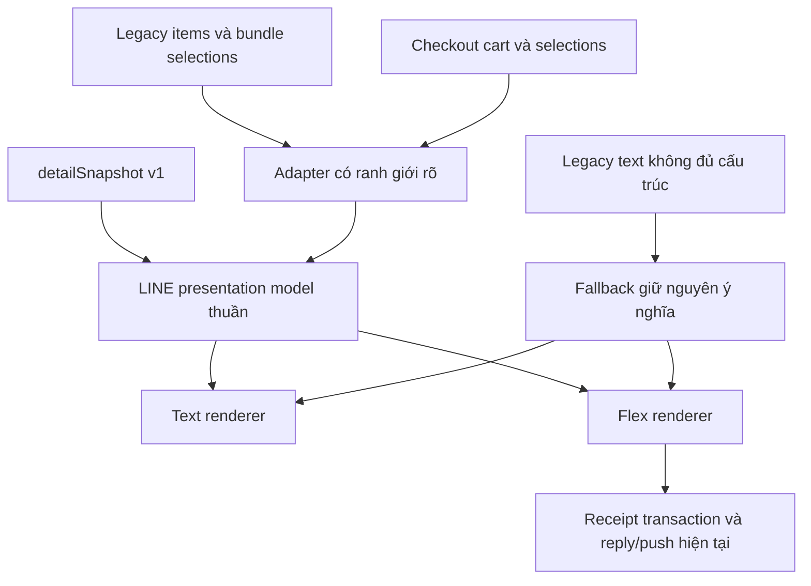

# PDP: LINE Order Receipt Portion Layout — Fix

Ngày: 2026-10-30. Trạng thái: đã triển khai cục bộ trên `codex/line-receipt-portions`, dựa trên main `b7178b8`. Chưa deploy; release gate còn lỗi có sẵn trên main. Xem [báo cáo triển khai và kiểm thử](implementation-and-verification.md).

## 1. Mục tiêu và phạm vi

Tin nhắn hiện gộp nhiều phần của một món/combo thành một khối chữ. Nhãn `第1份` lặp trên từng lựa chọn khiến người đọc khó xác định ranh giới giữa các phần. Thiết kế mới tạo cấu trúc **món → phần → nhóm tùy chọn → lựa chọn con**, đồng nhất ở tin nhắn text khách gửi và biên lai Flex bot gửi.

Mục tiêu nghiệm thu:

- Hai phần khác lựa chọn/ghi chú có hai nhóm độc lập, nhìn thấy ngay ranh giới.
- Món đơn, combo cũ, Unified Option Groups, nhóm toàn đơn và đơn nhiều vòng đều giữ đúng nội dung, số lượng, giá và phạm vi ghi chú.
- Nhãn nhóm lấy từ dữ liệu từng quán; không suy luận chức năng từ tên quán, category slug hoặc từ như “加料”, “辣度”.
- Chỉ gộp những phần có cấu hình giống hoàn toàn và dữ liệu đủ để chứng minh điều đó; thiếu dữ liệu thì giữ riêng.
- Không làm thay đổi dữ liệu bán hàng, quy tắc tính tiền, POS, lịch sử hoặc bản in.

Phạm vi là presentation và các test bảo vệ luồng liên quan. Không cần migration D1/KV hay sửa schema snapshot; không chuyển đổi dữ liệu lịch sử, không thiết kế lại menu khách/POS.

## 2. Kết quả khảo sát code hiện tại

| Đường xử lý | Vị trí | Ý nghĩa đối với thay đổi |
| --- | --- | --- |
| Text như ảnh khách gửi | `js/client-checkout.js`: `formatOrderTextMessage()`, `formatAppendItemsOnlyText()` | Nhánh bundle thêm prefix từng phần vào từng dòng; dùng cả trong payload `content`/`appended_content`, nên không được đổi format mà bỏ qua parser downstream. |
| Flex xác nhận | `benmi-worker-official/src/modules/line/templates/order-receipt.ts`: `buildOrderFlexMessage()` | Legacy bundle tạo một `bundleRows` chung cho mọi phần; snapshot chuyển qua `DetailView.lines()` và nối options thành một text. |
| Snapshot nguồn chuẩn | `benmi-worker-official/src/types/order-detail.ts`, `src/modules/order-detail.ts` | `DetailLine.portions` có index, groups và note; `DetailChoice` có lựa chọn con và subOptions. Đủ dữ liệu phân nhóm. |
| Contract dùng chung | `js/order-detail-view.js` | `lines()` giữ `detailLine`, nhưng options là projection phẳng. Không thay contract `lines()`, `printItems()` và `text()` chỉ để sửa LINE. |
| Đơn cũ | `js/order-legacy-adapter.js` | Ranh giới tương thích cho dữ liệu cũ; không áp parser text vào snapshot. |
| Biên lai và gửi tin | `src/modules/line-order-receipts.ts` | Payload Flex được lưu cùng transaction, reply/push/cron dùng claim + retry key. Layout không được thay đổi cơ chế này. |
| Snapshot create/append/modify | `src/modules/order-detail-write.ts` | Cả ba dùng `buildOrderFlexMessage()`. Cần test từng flow và round. |
| Legacy append/modify | `src/modules/orders.ts`, `line/templates/order-sold-out.ts` | Có builder riêng; cần audit để tránh chỉ sửa create mà để lại cùng lỗi ở đường khác. |

**Điểm tương thích quan trọng:** webhook hiện dùng chuỗi `📦 訂單內容：` để nhận diện create. Dọn emoji theo quy chuẩn UI phải đi cùng chuyển tiếp nhận diện header cũ/mới, backend trước frontend. `訂單編號`, `訂單參考`, `確認參考`, append/modify marker và internal order key vẫn là protocol, không phải text trang trí.

## 3. Kiến trúc đề xuất



### 3.1 Presentation model dành riêng cho LINE

Đề xuất helper pure UMD tại `js/line-order-presentation.js`, dùng được trong browser và Worker theo cách repo đang dùng cho `order-detail-view.js`. Worker thêm wrapper/type nếu cần. Không query catalog/D1 trong renderer.

Model gồm rounds, item identity, item name, quantity, authoritative subtotal (có thể unknown), item note và từng portion với source index, quantity, groups, choices, note. Choice giữ label, quantity, giá phụ thu và toàn bộ cây children/subOptions. Global groups và round/global notes có scope riêng.

Nguồn ưu tiên: snapshot hợp lệ → structured legacy items/bundle → text fallback. Snapshot đi trực tiếp từ `detailLine.portions`; không parse chuỗi do `DetailView.lines()` tạo. Mixed legacy/new rounds giữ thứ tự round nguồn, không đưa toàn bộ legacy text lên đầu.

Legacy adapter phải nhận đúng các hình dạng đang hỗ trợ: `bundleSelections`, `bundle_snapshot_json`, `{portions}`, array portions, array groups; options dạng array/JSON/string. Dữ liệu không giải mã được phải có fallback đọc được, không làm checkout/gửi receipt lỗi. Không bịa portion để giải quyết dữ liệu thiếu.

### 3.2 Quy tắc layout

- Header món: tên món đậm, tổng số lượng, **thành tiền dòng món** nếu có dữ liệu chuẩn. Nếu chỉ có đơn giá, ghi rõ `單價` thay vì trình bày như thành tiền. Giá bằng 0 vẫn hợp lệ; không dùng truthy fallback khiến mất số 0.
- Một phần: bỏ tiêu đề `第 1 份` thừa; nhóm tùy chọn nằm dưới món.
- Nhiều phần khác nhau: mỗi phần có tiêu đề riêng `第 1 份`, `第 2 份`, khoảng cách/box riêng; không lặp prefix trên từng lựa chọn.
- Giữ tên nhóm, thứ tự nhóm và lựa chọn. Không tự gom nhóm thành “加料”, không ẩn các mặc định như bình thường/không cay vì đó là thông tin chế biến.
- `×1` của một lựa chọn có thể bỏ; số lượng lớn hơn 1 luôn hiển thị. Tên lựa chọn chứa “x1” tự nhiên không được regex xóa.
- Lựa chọn con phải ở dưới/đi cùng lựa chọn cha; modifier của món con không trôi sang phần khác.
- Ghi chú toàn đơn, vòng, món và từng phần hiển thị đúng chỗ, đúng một lần trong scope. Cùng một ghi chú xuất hiện ở hai phần vẫn phải giữ ở cả hai phần.
- Nhãn cấu trúc mới có từ điển zh-TW/vi; tên món/nhóm từ snapshot giữ nguyên ngôn ngữ đã lưu. Không mở rộng dự án thành dịch lại toàn bộ receipt trong đợt này.

Ví dụ phần thân (giá lấy từ dữ liệu chuẩn, không suy ra từ ảnh):

```text
素筍飯糰 ×2
  第 1 份
    先選米：紫米
    份量調整：正常
    辣度選擇：不加辣
    加料10元：花生粉
    加料15元：皮蛋

  第 2 份
    先選米：紫米
    份量調整：加大
    辣度選擇：大辣
    加料15元：泡菜
```

Flex dùng box dọc cho từng phần, label regular màu xám, tên món/số lượng/thành tiền đậm; separator nhẹ giữa món. Không thêm icon trang trí.

### 3.3 Quy tắc gộp phần giống nhau

Chỉ gộp trong cùng item line, cùng round. So sánh cấu trúc đầy đủ: group/option/item identity nếu có, display names, quantities, surcharge, children/subOptions và note ở mọi cấp. Không gộp theo tên món hay text đã render. Không đổi thứ tự lựa chọn để ép hai phần thành giống nhau.

Gộp các phần liên tiếp giống hoàn toàn; ví dụ `第 1–2 份 · 相同設定` và chỉ hiển thị bộ lựa chọn một lần. Các phần không liên tiếp giữ riêng để bảo toàn thứ tự chế biến. Món hoàn toàn không tùy chọn/ghi chú có thể hiện một dòng `×2`. Dữ liệu legacy không chứng minh được equality thì không gộp. Đánh số nguồn không thay đổi sau khi gộp.

### 3.4 Giá, tổng tiền và kích thước payload

Renderer sử dụng snapshot subtotal/total và giá phụ thu từ projection chuẩn; không tính lại giá bán theo menu hiện tại, không cộng phụ thu lần hai. Với legacy chưa có subtotal đáng tin cậy, giữ nhãn đơn giá hoặc bỏ số chưa xác định. Kiểm tra giá 0, giảm giá, phụ thu lồng nhau và child quantity.

Flex hiện có `slice(0, 30)` ở nhiều nhánh; không xem cắt mất món là cách giải quyết dài quá giới hạn. Phase payload cần chốt thuật toán đóng gói trước khi triển khai: đo JSON UTF-8, phân trang theo item/portion, có nhãn tiếp trang; nếu không thể chứa toàn bộ trong giới hạn một payload được lưu thì dùng summary rõ “còn N món/phần” và đường xem chi tiết đã xác thực, đủ tenant và order scope. Chỉ dùng đường link thực sự tồn tại và đã kiểm tra; nếu chưa có thì phải triển khai và test trước khi bật fallback đó. Không âm thầm cắt, không tự thêm nhiều lần push ngoài receipt hiện tại.

Theo LINE: bubble tối đa 30 KB; carousel tối đa 50 KB và 12 bubble; text tối đa 5.000 ký tự. Cần kiểm tra thêm toàn bộ component/message constraints từ reference khi hiện thực. API validate và Simulator dùng để xác nhận payload, không thay thế kiểm tra hiển thị trên thiết bị.

Nguồn: [Messaging API reference](https://developers.line.biz/en/reference/messaging-api/), [Flex layout](https://developers.line.biz/en/docs/messaging-api/flex-message-layout/). LIFF Flex không phát webhook như text nên giữ đường text→webhook→bot Flex hiện tại: [LIFF API reference](https://developers.line.biz/en/reference/liff).

## 4. Rollout và rollback

1. Viết fixtures, characterization tests và presentation helper trước; runtime chưa đổi.
2. Backend nhận được header mới và cũ, giữ marker và idempotency. Triển khai dev, rồi xác nhận khách frontend cũ vẫn hoạt động.
3. Bật layout Flex tại dev; sau đó cập nhật text checkout và cache-buster/script load order trong `index.html` cùng mọi HTML thực sự tham chiếu file sửa/thêm.
4. Staging: fixture matrix, LINE validation và QA điện thoại thật; test frontend cũ/backend mới và frontend mới/backend tương thích trong rollout.
5. Chạy final release gate rồi mới release theo dev → staging → production. Không sửa trực tiếp main đang checkout để thử runtime.

Rollback bằng revert phần renderer/checkout và deploy lại môi trường bị ảnh hưởng. Giữ delivery adapter và page handler hỗ trợ envelope `receipt-pages` cho tới khi các receipt đã tạo hết thời gian retry; không rollback nguyên Worker về phiên bản chưa hiểu envelope này khi vẫn còn receipt phân trang pending. Header protocol cũ được giữ nguyên trong triển khai. Receipt đã lưu giữ nguyên payload, retry không render lại theo code mới. Không sửa dữ liệu lịch sử, không replay các receipt đã sent. Dừng rollout nếu có lẫn phần/ghi chú, sai tiền, thiếu món hoặc LINE reject payload.

## 5. Phương án và trade-off

| Phương án | Lợi ích | Chi phí/rủi ro | Kết luận |
| --- | --- | --- | --- |
| Chỉ thêm xuống dòng tại prefix | Nhanh | Snapshot vẫn phẳng, text/Flex dễ lệch, thiếu kiểm soát nested groups | Không chọn |
| Đổi toàn bộ `OrderDetailView.lines/text/printItems` | Dùng chung một thay đổi | Ảnh hưởng POS, content persisted và máy in ngoài phạm vi | Không chọn |
| Presentation LINE riêng, nguồn chuẩn và adapter rõ | Cô lập thay đổi, test được cả hai renderer | Thêm helper và fixtures | Chọn |

## 6. Các yêu cầu xuyên suốt

- Tenant isolation: chỉ nhận context và snapshot/order đã được luồng hiện tại kiểm tra; không tải catalog tenant khác. Không hardcode tên quán/category.
- Không ghi log tên khách, ghi chú hay nội dung món đầy đủ. Theo dõi log receipt hiện có: event, flow, receiptId, tenantId, HTTP status; bổ sung lý do fallback/kích thước payload nếu cần.
- Pure transformation theo số node lựa chọn; không network call ở render, không thay KV/bootstrap invalidation.
- Snapshot cũ vẫn render theo historical names/prices khi menu sửa/xóa. Không thay validation hay canonical key của checkout.

## 7. Các bước phát triển

- [x] P1 — Fixtures + characterization; sửa lỗi option tên số `123`.
- [x] P2 — Pure model + text/Flex renderer, adapter legacy, grouping, giá và phân trang.
- [x] P3 — Backend create/append/modify, round order và receipt transaction. Giữ header protocol cũ nên không cần đổi parser nhận diện header.
- [x] P4 — Checkout display text, tách canonical persisted/fallback text, load order và cache-buster.
- [x] P5 — Targeted regression và evidence; 66/66 tests đạt ở lần cuối.
- [ ] P6 — Full release gate đã chạy: 23/28 suite đạt, 5 suite lỗi tái hiện trên main sạch. QA dev/staging, LINE validate và điện thoại thật chưa thực hiện; cần xử lý gate trước phát hành.

## 8. Ma trận kiểm thử và điều kiện nghiệm thu

### 8.1 Unit/contract fixtures mới

Đề xuất `tests/test_line_order_presentation.cjs`, `tests/test_line_order_layout.cjs`, `tests/fixtures/line-order-layout.cjs`. Mỗi fixture chạy text và Flex; so sánh nội dung ngữ nghĩa và phạm vi, không chỉ snapshot JSON hay kiểm tra có chứa tên món.

| Nhóm | Ca bắt buộc | Assertion chính |
| --- | --- | --- |
| Món thường | 1 phần, nhiều phần không options, tên trùng nhưng ID khác | Đúng qty/identity; không gộp xuyên item |
| Tái hiện ảnh | 2 phần cùng món, gạo giống, size/cay/topping khác, kèm món khác | Hai portion box; lựa chọn chỉ thuộc đúng phần |
| Gộp | Giống hoàn toàn; chỉ khác note/giá/qty/child; giống nhưng không liên tiếp | Chỉ gộp trường hợp đủ bằng chứng; index giữ đúng |
| Unified options | Radio, multiple, repeats, required/default, nhóm global/category/item | Label và thứ tự động; không mất số lượng hoặc default |
| Combo | 1/2/3 phần; child products, child modifiers, nhóm lồng nhiều cấp | Giữ cây cha/con và phụ thu đúng nguồn |
| Legacy schema | Object/JSON, portions/array groups, options array/string, JSON lỗi | Tương thích hình dạng cũ; fallback không crash hoặc mất nội dung |
| Ghi chú | Global/round/item/portion, trùng chữ khác scope, newline, rỗng | Một lần mỗi scope; không dedupe nhầm hai phần |
| Giá | 0, subtotal 0 explicit, quantity >1, surcharge, discount, decimals, unknown | Thành tiền không bị double-count; unknown không thành $0 giả |
| Nhiều vòng | Create→append→modify, mixed legacy/new, sửa một round | Chỉ scope dự kiến đổi; thứ tự round và tổng chuẩn |
| Dữ liệu lịch sử | Rename/delete menu/option sau khi đặt, tên giống ID khác | Giữ historical names/prices; không tra catalog để thay thế |
| Ngôn ngữ/text | zh-TW, vi, tên dài, Unicode, ký tự phân cách/HTML, hơn 10 phần | Không cắt tên/hiểu nhầm note thành marker; wrap hợp lệ |
| Dài/biên | 29/30/31+ items, nhiều groups, sát/vượt payload budget, text 5.000 | Đúng packing/fallback; số mục còn lại rõ; không cắt im lặng |
| Không mutation | Render nhiều lần cùng input, freeze input | Deterministic; snapshot/order đầu vào không đổi |

Test cây Flex phải xác nhận node con nằm trong đúng phần, thứ tự, note scope và số lần xuất hiện; không chỉ `JSON.stringify(...).includes(...)`.

### 8.2 Integration và regression hiện có

Chạy trên Node 24 tại root, trong quá trình phát triển chỉ dùng suite mục tiêu:

```bash
npm run check
npm run --prefix benmi-worker-official check
npm run test:line-order-receipts
npm run test:liff-message-retry
npm run test:order-details
npm run test:item-notes
node --test tests/test_bundle_display_all_touchpoints.cjs
npm run test:menu-regression
npm run test:cluster2
npm run test:new-menu
npm run test:unified-menu
npm run test:order-detail-layout
npm run check:cache-busters
```

Máy in: repo **không có npm script `test:print-identity`** dù testing-workflow có nhắc; dùng lệnh thật:

```bash
node tests/test_order_identity_print.cjs
node tests/test_order_print_items.js
node tests/test_order_print_subtotal_bundle.cjs
```

Thêm integration assertions vào `scripts/test-line-order-receipts.cjs` và snapshot tests: payload lưu transaction đúng layout, reply/push cùng nội dung; webhook header cũ/mới không tạo đơn trùng; retry/cron/concurrency không gửi thêm; append/modify không mất grouping. Test khách guest/desktop và LIFF thiếu quyền vẫn dùng fallback đúng recipient.

Đưa suite LINE mới vào `scripts/check-release-baseline.mjs` để cổng cuối tự chạy. Kiểm tra danh sách gate: nhiều suite menu đã có trong `scripts/menu-qa/suites.mjs`; chạy riêng các suite còn thiếu, không giả định `test:release` tự bao phủ mọi file.

Cuối cùng trước PR/deploy chạy **một lần** `npm run test:release`, lưu logs/summary/screenshots tại `artifacts/release-baseline/<timestamp>`. Chỉ xem đạt khi exit 0, không skipped/todo; lỗi môi trường hoặc baseline cũ phải báo rõ và xử lý trước release, không hạ gate.

### 8.3 QA thực tế

- Tái hiện ảnh với cùng cấu trúc 2 phần khác nhau, rồi kiểm tra combo bánh mì + đồ uống, món nhiều topping, món không tùy chọn và đơn mixed.
- QA LINE iOS/Android, cỡ chữ thường/lớn: tên dài wrap, giá đọc rõ, không tràn box hoặc mất phần khi message dài. WebKit/Chromium tests bảo vệ checkout/POS; không coi chúng là renderer LINE thật.
- Flex Simulator + LINE validate reply/push với fixture đã khử dữ liệu cá nhân; API validation không gửi tin. Tin nhắn thử thực tế chỉ gửi vào tài khoản/kênh QA đã được chỉ định.
- Quan sát text khách gửi lẫn Flex bot trả; marker vẫn xử lý, mỗi flow chỉ có một receipt, buttons/LIFF links/table/pickup time đúng như trước.
- Kiểm tra POS live/history, receipt và sticker trước/sau cùng fixture: item, options, notes và totals không đổi.

### 8.4 Trạng thái kiểm tra lúc lập kế hoạch

Đã chạy baseline cục bộ trên Node v24.22.0, trước khi sửa runtime:

```bash
node --experimental-sqlite --test --test-reporter=tap scripts/test-line-order-receipts.cjs scripts/test-liff-message-retry.cjs tests/test_order_detail_snapshots.cjs tests/test_order_detail_groups.cjs tests/test_order_item_note_dedup.cjs tests/test_menu_compatibility_regression.cjs tests/test_cluster2_combo_bundle_rules.cjs
```

Kết quả: **49 tests, 48 pass, 1 fail, 0 skipped/todo**. Lỗi có sẵn tại `tests/test_order_item_note_dedup.cjs:125`: option có display value `123` bị printer parser bỏ thành chuỗi rỗng (`expected '123', actual ''`). Chạy riêng file notes cũng tái hiện lỗi. Đây là hạng mục P1 phải giải quyết trước nghiệm thu; không đánh dấu baseline đạt.

Evidence cục bộ: `/tmp/benmi-line-layout-plan-baseline.log`, `/tmp/benmi-line-layout-note-baseline.log` (file tạm, không phải artifact lưu lâu dài). Chưa chạy full release gate vì chưa có thay đổi runtime và chưa chuẩn bị PR/deploy; chưa gửi tin LINE thật. Các test mới ở ma trận là kế hoạch cần triển khai, chưa được tính là đã pass.
