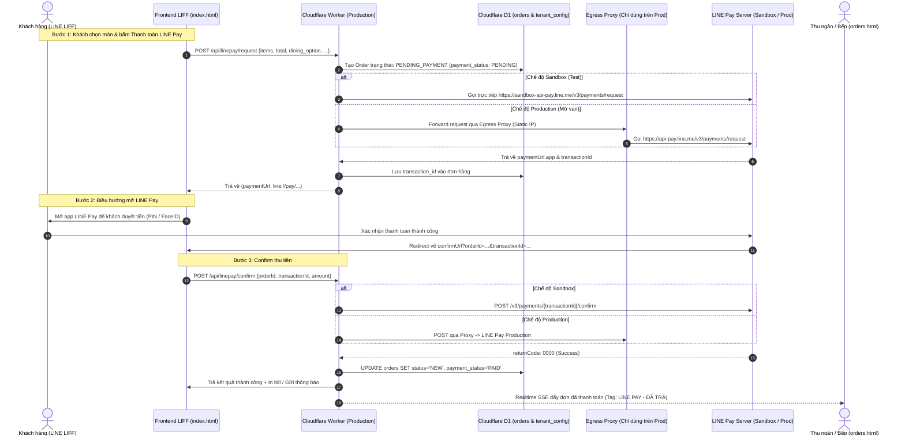

# Kế hoạch Tích hợp LINE Pay v3 & Continuous Delivery lên Production

Tài liệu thiết kế kỹ thuật và lộ trình tích hợp cổng thanh toán **LINE Pay v3** vào hệ thống **Benmi Multi-Tenant Order Platform** theo phương pháp **Continuous Delivery (Dark Launching / Feature Flagging)**.

---

## 1. Goal Description

Hệ thống Benmi hiện tại xử lý đơn hàng theo hình thức thanh toán trực tiếp/tiền mặt khi nhận món. Mục tiêu là:
1. **Tích hợp LINE Pay v3** cho khách hàng đặt món qua LIFF Menu (`index.html`) và đồng bộ trạng thái thanh toán đến màn hình POS thu ngân (`orders.html`).
2. **Chiến lược Continuous Delivery (CD)**: Code liên tục được merge và deploy lên môi trường Production (`benmi-worker-official.thuanmnc.workers.dev`) mà **100% không làm gián đoạn** hoạt động bán hàng của các quán hiện tại.
3. **Môi trường Sandbox**: Toàn bộ logic được kích hoạt và kiểm thử nội bộ trên Sandbox của LINE Pay trước.
4. **Cơ chế "Mở van" (Feature Toggle)**: Khi kiểm thử hoàn tất và cổng LINE Pay duyệt tài khoản thật, chỉ cần bật cờ tính năng (`line_pay`) trong `tenant_config` là quán lập tức có thể nhận thanh toán tiền thật mà không cần deploy lại code.

---

## 2. Kiến trúc Giải pháp & Sơ đồ luồng (Architecture & Flow)



---

## 3. User Review Required

> [!IMPORTANT]
> **Quy trình Mở Van (Feature Toggling)**:
> Mặc định khi deploy lên Production, toàn bộ code LINE Pay sẽ nằm ở trạng thái **"Dark Launch" (Ẩn hoàn toàn)**.
> Chỉ những tenant nào có cấu hình `features: ["line_pay", ...]` trong `tenant_config` mới hiển thị nút thanh toán LINE Pay. Các tenant hiện tại (`benmi`, `bsc`, v.v.) vẫn giữ nguyên giao diện cũ 100%.

> [!WARNING]
> **Điểm khác biệt giữa Sandbox và Production**:
> - **Sandbox**: Cloudflare Worker gọi trực tiếp sang `sandbox-api-pay.line.me` (không cần IP Whitelist).
> - **Production**: Khi "mở van" nhận tiền thật, bắt buộc cấu hình thêm `line_pay_proxy_url` trong `tenant_config` để request đi qua Static IP đã được whitelist trên cổng LINE Pay Merchant.

---

## 4. Open Questions

1. **Chính sách hủy đơn / hoàn tiền (Refund Policy)**:
   - Trong giai đoạn 1 (MVP), khi thu ngân từ chối đơn (`REJECTED`) trên POS, hệ thống sẽ chỉ ghi nhận hủy đơn và nhân viên hoàn tiền thủ công tại quầy/qua app LINE Pay, hay bạn muốn hệ thống tự động gọi API `POST /v3/payments/{transactionId}/refund` của LINE Pay ngay lập tức?
   *Khuyến nghị MVP: Cho phép thu ngân bấm nút "Hoàn tiền LINE Pay" trên POS modal để gọi API refund.*

2. **Tên tenant dùng để test Sandbox trên Production**:
   - Chúng ta sẽ dùng tenant `blab-demo` hoặc tạo một tenant test riêng biệt trên Production DB để chạy test Sandbox có đúng không?

---

## 5. Proposed Changes (Chi tiết kỹ thuật)

### Database Layer (Cloudflare D1 Migrations)

#### [NEW] `benmi-worker-official/migrations/0068_add_line_pay_support.sql`
- Thêm các trường lưu trữ trạng thái thanh toán vào bảng `orders`:
  - `payment_method TEXT DEFAULT 'cash'` ('cash' | 'line_pay')
  - `payment_status TEXT DEFAULT 'PENDING'` ('PENDING' | 'PAID' | 'FAILED' | 'CANCELLED' | 'REFUNDED')
  - `line_pay_transaction_id TEXT DEFAULT NULL`
  - `line_pay_order_id TEXT DEFAULT NULL`
  - `line_pay_paid_at DATETIME DEFAULT NULL`
- Thêm cấu hình LINE Pay vào bảng `tenant_config`:
  - `line_pay_channel_id TEXT DEFAULT NULL`
  - `line_pay_channel_secret TEXT DEFAULT NULL`
  - `line_pay_sandbox INTEGER DEFAULT 1` (1 = Sandbox, 0 = Production)
  - `line_pay_proxy_url TEXT DEFAULT NULL` (URL của Micro Egress Proxy cho Production)
- Chỉ mục (Index) tăng tốc tìm kiếm theo `line_pay_transaction_id`.

---

### Backend Layer (`benmi-worker-official`)

#### [NEW] `benmi-worker-official/src/modules/line-pay.ts`
- Xây dựng module độc lập xử lý giao tiếp LINE Pay v3:
  - `generateLinePaySignature(secret, uri, bodyOrQuery, nonce)`: Tạo HMAC-SHA256 signature theo chuẩn LINE Pay v3.
  - `requestPayment(tenantCtx, payload)`: Gọi `POST /v3/payments/request` (tự động nhận diện Sandbox hoặc Production qua Proxy).
  - `confirmPayment(tenantCtx, transactionId, amount, currency)`: Gọi `POST /v3/payments/{transactionId}/confirm`.
  - `refundPayment(tenantCtx, transactionId, refundAmount)`: Gọi `POST /v3/payments/{transactionId}/refund`.

#### [MODIFY] `benmi-worker-official/src/index.ts`
- Bổ sung routing:
  - `POST /api/linepay/request` -> `handleLinePayRequest(request, env, ctx, tenantCtx)`
  - `POST /api/linepay/confirm` -> `handleLinePayConfirm(request, env, ctx, tenantCtx)`
  - `GET /api/linepay/check` -> Kiểm tra trạng thái đơn hàng khi redirect về.

#### [MODIFY] `benmi-worker-official/src/modules/bootstrap.ts`
- Đưa cờ `linePayEnabled: boolean` vào `bootstrapResponse.tenant` để Frontend LIFF biết tenant đó có hỗ trợ LINE Pay hay không.

#### [MODIFY] `benmi-worker-official/src/modules/orders.ts`
- Cập nhật hàm tạo đơn và hàm cập nhật đơn để hỗ trợ `payment_method` và `payment_status`.
- Đảm bảo SSE broadcast báo về POS biết đơn hàng đã thanh toán qua LINE Pay.

---

### Frontend Layer (LIFF Customer Menu & POS Dashboard)

#### [MODIFY] `index.html` & `js/client-checkout.js`
- **Giao diện chọn hình thức thanh toán (Payment Method Selector)**:
  - Hiển thị khối lựa chọn: `Tiền mặt / Tại quầy` hoặc `LINE Pay` (Có logo LINE Pay nét mảnh, chuẩn tối giản).
  - Khối này **chỉ hiển thị** khi `bootstrapData.tenant.features.includes('line_pay')`. Nếu không có, mặc định giữ nguyên 100% luồng cũ.
- **Xử lý luồng Submit**:
  - Nếu chọn LINE Pay: Gọi `POST /api/linepay/request`. Nhận `paymentUrl.app`, chuyển hướng khách hàng sang app LINE (`window.location.href = res.paymentUrl.app`).
  - Trang xác nhận đơn tiếp nhận `transactionId` từ URL callback, gọi `POST /api/linepay/confirm`, hiển thị receipt đã thanh toán.
- **Cache-busting (Bắt buộc)**:
  - Tăng version cache-buster trong `index.html`: `?v=20261020_linepay_checkout_v1`.

#### [MODIFY] `orders.html` & `css/orders.css` & `js/orders-display.js`
- Hiển thị badge trực quan trên thẻ đơn hàng tại POS:
  - Thẻ màu xanh ngọc: `[LINE Pay - Đã thanh toán]` hoặc `[Tiền mặt - Thu tiền tại quầy]`.
- Khai báo đầy đủ đa ngôn ngữ trong cả 2 từ điển `I18N["zh-TW"]` và `I18N["vi"]` (Không pha trộn ngôn ngữ).
- Tăng version cache-buster: `?v=20261020_linepay_pos_v1`.

---

## 6. Lộ trình Triển khai & Giao hàng Liên tục (Rollout Phases)

### Giai đoạn 1: Triển khai Code Nền (Dark Launch to Production)
1. Viết code backend `src/modules/line-pay.ts`, API endpoints và migration D1.
2. Viết UI frontend với điều kiện rẽ nhánh feature flag.
3. Chạy kiểm tra tĩnh `npm run check` đảm bảo không có lỗi scope/cú pháp.
4. Chạy migration trên Production D1: `npm run db:migrations:apply:production`.
5. Deploy code lên Production Worker: `npm run deploy`.
   *👉 Trạng thái lúc này: Code đã có trên Production, nhưng KHÔNG MỘT KHÁCH HÀNG NÀO nhìn thấy tính năng này vì chưa tenant nào bật flag.*

### Giai đoạn 2: Bật Sandbox & Kiểm thử E2E trên Production
1. Cấu hình Channel ID & Secret Sandbox của LINE Pay vào tenant test (ví dụ `blab-demo`):
   - `line_pay_sandbox = 1`
   - `features = ["line_pay", ...]`
2. Truy cập LIFF của tenant test:
   - Thử nghiệm đặt món chọn LINE Pay.
   - Kiểm tra mở app LINE Pay Sandbox -> Thanh toán thành công -> Nhận đơn trên POS.
   - Kiểm tra các trường hợp biên: Người dùng bấm Hủy thanh toán, app bị treo, hết hạn thanh toán, thanh toán lại.

### Giai đoạn 3: Chuẩn bị Hạ tầng Production (Egress Proxy)
1. Khởi tạo 1 máy ảo micro VPS (AWS Lightsail / DigitalOcean / Vultr) với Static IP (ví dụ: `54.x.x.x`).
2. Cài proxy forward request sang `https://api-pay.line.me/v3/`.
3. Điền Static IP vào cổng **LINE Pay Merchant Center** (`Manage Payment Server IP`).
4. Cập nhật `line_pay_channel_id` (Prod), `line_pay_channel_secret` (Prod), và `line_pay_proxy_url` vào `tenant_config`.

### Giai đoạn 4: "MỞ VAN" (Go-Live chính thức)
1. Cập nhật `tenant_config` của quán thật (ví dụ `benmi`):
   - Đặt `line_pay_sandbox = 0`.
   - Thêm `'line_pay'` vào cột `features`.
2. Gọi API `invalidateBootstrapCache('benmi', env)` để xóa cache KV.
3. Khách hàng của quán bắt đầu thấy nút thanh toán LINE Pay ngay lập tức.
4. *Nếu có bất kỳ sự cố gì: Chỉ cần xóa `'line_pay'` khỏi `features`, van sẽ đóng ngay lập tức trong 1 giây mà không cần rollback code.*

---

## 7. Verification Plan

### Automated Tests & Static Checks
```bash
# 1. Kiểm tra tĩnh cú pháp và scope frontend
npm run check

# 2. Type-check backend TypeScript
cd benmi-worker-official && npm run build
```

### Manual Verification
1. **Kiểm tra tính tương thích ngược (Regression Test)**:
   - Truy cập tenant thật (`benmi`) -> Đảm bảo giao diện đặt món cũ và quy trình checkout tiền mặt hoạt động 100% bình thường.
2. **Kiểm tra Sandbox trên LIFF (Test Tenant)**:
   - Vào LIFF test -> Chọn 2 món -> Chọn LINE Pay -> Chuyển sang LINE Pay Sandbox -> Nhập mã OTP/Sandbox test -> Hoàn tất.
   - Mở `orders.html` -> Thẻ đơn hiện tag "LINE Pay - Đã thanh toán".
3. **Kiểm tra cơ chế Đóng/Mở van tức thì**:
   - Thử bật/tắt flag `line_pay` trong D1 và kiểm tra giao diện LIFF tự động ẩn/hiện tùy chọn thanh toán.
