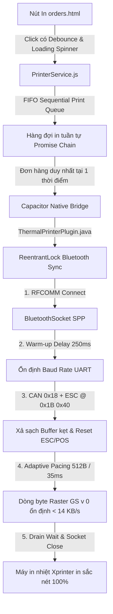

# PDP: Xprinter Bluetooth SPP Buffer Stabilization & Sequential Print Queue [Fix]

| Status | Approved via `/grill-me` |
| :--- | :--- |
| **Author** | Principal Systems Architect |
| **Target Platforms** | Android Tablet POS (Capacitor Native) & Web Simulator |
| **Repository Scope** | `apps/android-pos/android/app/src/main/java/com/benmi/pos/`, `js/printer-service.js`, `orders.html`, `js/orders-modals.js`, `js/orders-i18n.js`, `css/orders.css` |
| **Target Branch** | `dev` |

---

## 1. Executive Summary & Root Cause Analysis

### 1.1 Hiện tượng lỗi (Symptom)
Khi thao tác in thủ công (manual print) hóa đơn thu ngân hoặc in cả đơn qua kết nối Bluetooth tới máy in nhiệt **Xprinter (dòng XP-58 / XP-80 / XP-N160II)**:
- Thỉnh thoảng máy in tuôn ra giấy dài chứa toàn **ký tự hỗn loạn (mojibake / gibberish)**.
- Khi người dùng bấm in lại 2–3 lần thì máy in lại hoạt động bình thường trở lại.

### 1.2 Điều tra nguyên nhân gốc rễ (Root Cause Investigation)
Qua điều tra chi tiết mã nguồn tầng Android Native Java và JavaScript, xác định 4 nguyên nhân kỹ thuật phối hợp gây ra lỗi:

1. **Thiếu khoảng trễ ổn định RFCOMM (Warm-up Delay)**:
   - Trong `ThermalPrinterPlugin.java`: Ngay sau khi `socket.connect()` hoàn thành, luồng ghi bắt đầu ghi dữ liệu ngay tức thì ở miligiây 0.
   - Module Bluetooth tích hợp trên Xprinter (chip BK3231 hoặc CSR) cần 150ms–250ms để đồng bộ hóa tốc độ baud rate với vi điều khiển (MCU) máy in qua bus UART nội bộ.
   - Do đó, 4–16 byte đầu tiên (chứa lệnh khởi tạo `ESC @` `[0x1B, 0x40]` và tiêu đề raster `GS v 0` `[0x1D, 0x76, 0x30, 0x00, xL, xH, yL, yH]`) bị cắt mất hoặc biến dạng trên đường truyền UART.
   - Khi thiếu mất `GS v 0`, máy in Xprinter **không nhận diện đây là ảnh nhị phân** mà giữ nguyên chế độ mặc định **Text Mode**. Kết quả là hàng chục nghìn byte raster nhị phân (0x00–0xFF) bị giải mã thành font chữ bảng mã ký tự, tuôn ra hàng dài ký tự hỗn loạn.

2. **Tràn bộ đệm UART do tốc độ bơm dữ liệu (Buffer Overrun)**:
   - Code hiện tại chia khối `chunkSize = 1024` byte và chỉ nghỉ `15ms` giữa các khối. Tốc độ truyền đẩy lên tới ~`68 KB/s`.
   - Bus UART nội bộ của Xprinter thường chạy ở baud rate 9600–115200 bps (tương đương tối đa ~`11.5 KB/s`), và bộ đệm nhận (Rx Buffer) của phần cứng chỉ có dung lượng nhỏ từ 2KB đến 4KB (hoặc tối đa 8KB).
   - Tốc độ truyền 68 KB/s làm tràn hoàn toàn bộ đệm phần cứng, gây rớt byte (dropped bytes) ở giữa stream ảnh `GS v 0`. Một khi bị mất byte, máy in mất căn lề byte raster và lập tức rơi về chế độ Text Mode in ra rác.

3. **Đóng socket vội vàng (`socket.close()`) để lại byte kẹt trong bộ đệm**:
   - `waitTimeMs` trong code hiện tại chỉ chờ từ 800ms–4000ms. Khi file in dài, máy in đang kéo giấy thì socket RFCOMM bị đóng đột ngột.
   - Một lượng byte dở dang còn kẹt lại trong bộ đệm của máy in. Ở lần in tiếp theo, dữ liệu mới bị nối vào đuôi dữ liệu cũ gây lỗi tiếp. Sau 2–3 lần bấm in hoặc chờ giấy nhả xong, bộ đệm được xả sạch thì máy in mới phục hồi bình thường.

4. **Xung đột đa luồng (Concurrency Collision) & Thiếu Debounce trên giao diện**:
   - `ThermalPrinterPlugin.java` sử dụng `Executors.newFixedThreadPool(3)` nhưng không có khóa đồng bộ (`Lock` / `synchronized`) cho thiết bị Bluetooth.
   - Trên UI `orders.html`, các nút in thủ công không có cơ chế vô hiệu hóa (disable) khi đang in. Khi nhân viên sốt ruột bấm đúp (double-click), 2 luồng Java cùng mở kết nối RFCOMM đến 1 địa chỉ MAC của máy in cùng lúc, gây giao thoa byte và làm hỏng toàn bộ gói lệnh ESC/POS.

---

## 2. Giải pháp kiến trúc toàn diện (Architecture Specification)

### 2.1 Cải tiến tầng Android Native (`ThermalPrinterPlugin.java` & `EscPosBitmapConverter.java`)
1. **Khóa đồng bộ Bluetooth (`BT_PRINT_LOCK`)**: Dùng `ReentrantLock` đảm bảo tại một thời điểm chỉ có đúng 1 lệnh in được phép chiếm giữ kênh RFCOMM.
2. **Warm-up Delay (250ms)**: Thêm khoảng dừng 250ms ngay sau `socket.connect()` để UART máy in ổn định.
3. **Chuỗi khởi tạo an toàn (Buffer Sanitization & Reset)**:
   - Gửi byte `0x18` (`CAN` - Hủy dữ liệu lỗi còn sót lại trong bộ đệm máy in).
   - Gửi `0x1B, 0x40` (`ESC @` - Khởi tạo lại trạng thái máy in).
   - Nghỉ 50ms để MCU máy in áp dụng lệnh reset.
4. **Adaptive Pacing chống tràn bộ đệm**:
   - `chunkSize = 512` bytes.
   - `Thread.sleep(35)` ms giữa các chunk (tốc độ ~`14.6 KB/s`, hoàn toàn tương thích và an toàn với bộ đệm 2KB–4KB của Xprinter).
5. **Drain/Teardown Wait Time**: Chờ máy in nhả giấy hoàn tất trước khi đóng socket.

### 2.2 Cải tiến tầng JavaScript (`js/printer-service.js`)
1. **FIFO Sequential Print Queue**: Mọi lệnh in đều được xếp hàng qua `enqueuePrintTask(taskFn)`.
2. **Global Printing State**: Quản lý trạng thái `PrinterService.isBusy` và phát sự kiện `printer-state-changed`.

### 2.3 Cải tiến tầng Giao diện (`orders.html`, `js/orders-modals.js`, `css/orders.css`, `js/orders-i18n.js`)
1. **Debounce & Loading State trên nút bấm**: Tự động vô hiệu hóa nút in (`disabled="true"`, thêm class `is-printing`) và hiển thị Toast trạng thái.
2. **Hỗ trợ đa ngôn ngữ (I18N)**: Bổ sung đầy đủ key song ngữ cho tiếng Trung phồn thể (`zh-TW`) và tiếng Việt (`vi`).
